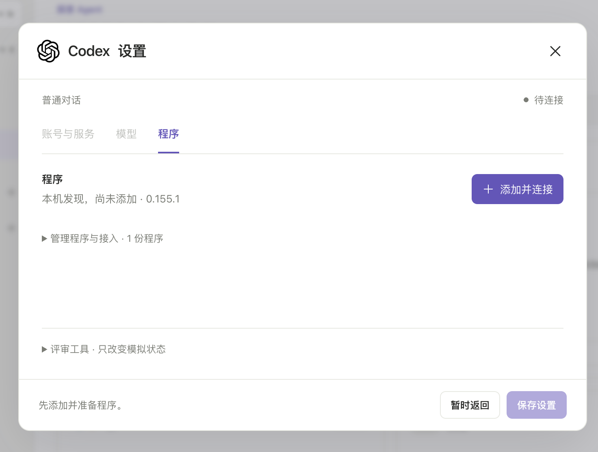
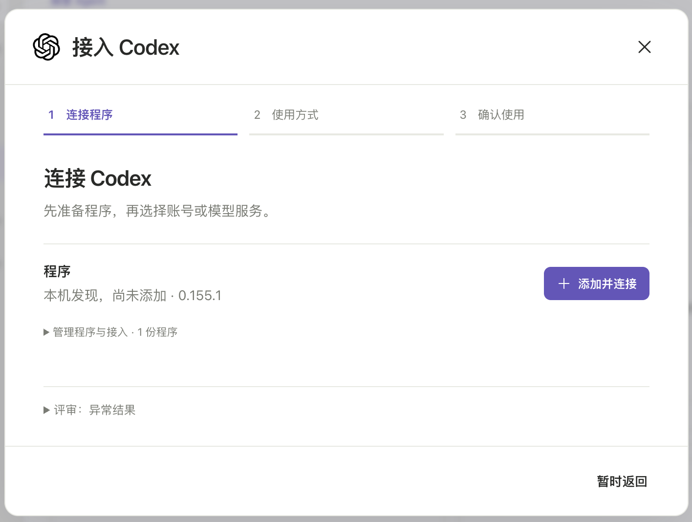
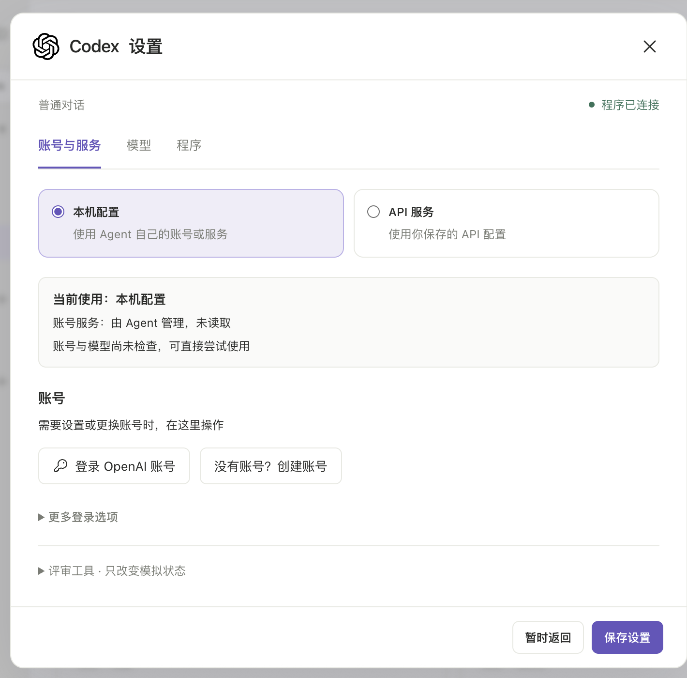

# Agent 接入入口检查 · 2026-09-28

## 结论

当前最新原型仍存在首次接入与日常管理的入口分叉。上一轮旧文件清理不等于该流程已统一。本轮只做截图、页面操作和源码核查，未修改原型代码，未重置用户当前演示进度。

## 三张用户截图

1. **首次点击设置图标：有问题。**未添加 Codex 进入日常设置页，保留“保存设置”并禁用账号/模型页签。程序连接被嵌入管理流程，缺少后续使用方式和确认引导。

2. **首次点击准备使用：主路径清楚，但入口覆盖不完整。**三步为连接程序、使用方式、确认使用。与图 1 为同一个 Agent、同一初始准备条件，两入口却采用不同完成规则。

3. **从管理页连接后：有问题。**“程序已连接”只说明程序连接成功；“当前使用：本机配置”过早表达已确认选择。尚未走完向导也可能获得“开始新对话”。沿用 Agent 已有配置、账号未知时允许尝试可以成立；不能因此跳过用户对使用方式的确认，也不能把未知等同于已登录。

## 当前页面复核

- 未添加 Pi 的设置图标复现与图 1 相同的管理页（`02-first-gear.png`）。
- 已连接 Codex 的设置页与图 3 一致（`03-connected-gear.png`）。
- 当前目录 Codex/OpenCode 显示“开始新对话”，Cline 显示“继续准备”；真实是否完成需按现有上下文判断，不能仅凭卡片推断已认证。

## 源码原因

- `AgentHub.jsx`：主按钮未就绪时使用 `intent=use`，齿轮使用 `intent=manage`。
- `onboarding-state.js`：manage 直接排除三步向导。
- `setup-entry.js`：只有已经保存 onboarding.step 才算待完成；从未启动向导不会被识别。
- `access-jobs.js`：连接成功仍保持 setupComplete=false。
- `agent-setup-state.js`：agentCanAttempt 只要求程序就绪且没有阻塞操作，没有判断首次接入是否已完成。
- 因此首次从齿轮连接程序后，没有向导进度，同时可直接开始；先从主按钮进入则保存了向导进度。行为取决于首次点击哪个按钮。

## 应统一的规则

- 未完成接入：任何开始/设置入口都进入或继续同一向导。
- 只连上程序：保留接入未完成状态，进入使用方式。
- 明确确认使用方式与模型后：允许开始新对话，设置图标进入日常管理。
- 已有设置可以沿用；登录和短测按实际缺失条件处理，不强制重新登录。
- 退出、重启、失败返回保持对应进度；不要用“有没有向导记录”代替“是否完成准备”。

## 视觉与可访问性风险

管理页大片空白、禁用页签和灰色底部说明让下一步不够明确；“保存设置”与已即时发生的程序连接动作之间的关系不清楚。截图可见低对比灰色说明和禁用项，但本轮未测对比度数值，未做完整键盘/读屏合规审查。

页面与逻辑均为模拟原型；未执行真实 Agent 登录或请求。
