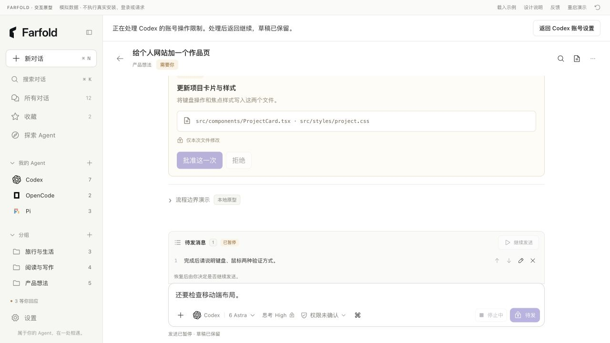
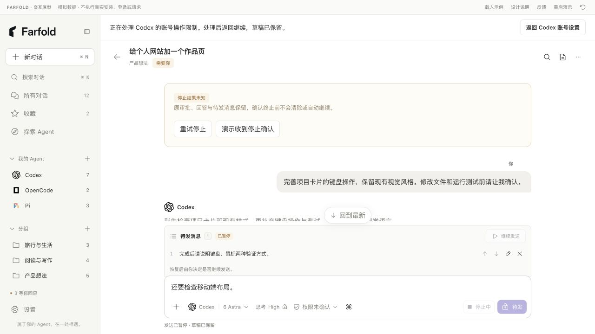
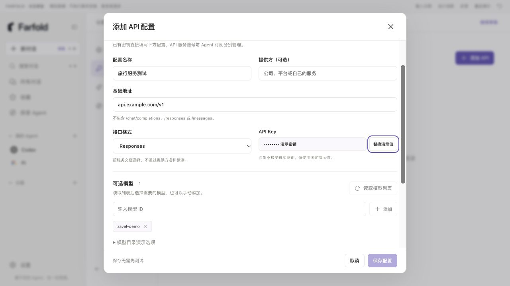

# Farfold 原型：模拟真人使用检查

后续修复：本报告发现的两项问题已完成原型修改与复测，见 [修复结果](fixes/README.md)。下文保留当时的原始发现。

日期：2026-09-28  
范围：当前 8847 端口的交互原型；通过可见界面操作。测试使用 localhost 的独立演示状态，用户 127.0.0.1 页面未重置、未改动。窗口为本次默认的 1280 × 720。

## 结论

本轮确认 2 个可复现的问题：停止结果未知时，底部反馈与恢复入口脱节；API 配置无效时，没有字段错误说明。未在已覆盖路径中再次遇到未完成接入却跳回旧设置流程的问题。

本轮只检查和记录，未修改产品代码。页面明确标注安装、登录、请求均为模拟；本报告不代表真实 Agent 或安装版验收。

## 检查路径与结果

| 顺序 | 用户任务 | 结果 | 证据 |
| --- | --- | --- | --- |
| 1 | 首次打开，先写旅行问题并添加示例附件，再去接入 Agent | 草稿和附件保留 | [草稿及附件](01-draft-file.png) |
| 2 | Codex 登录未完成时离开，改用 Pi，再回来继续 Codex | Pi 可独立完成接入；Codex 从原向导继续登录；未出现第二套未完成接入流程 | [等待登录](02-codex-waiting.png)、[返回草稿](03-draft-return-pi.png) |
| 3 | 用 Pi 发出首条消息，再写跟进草稿；新草稿切换 Agent、取消模型选择 | 示例回复可见；跟进草稿保留；取消模型选择不改当前模型 | [首条示例回复](04-pi-first-message.png) |
| 4 | 从已有对话另开对话，同时已有未发送的新草稿 | 明确提示草稿冲突；取消后两份草稿保留；已有对话设置保持固定 | [草稿保护](05-draft-protection.png) |
| 5 | 冷打开历史，模拟读取失败，再重试；归档后搜索并打开 | 失败有重试入口；恢复后草稿仍在；搜索包含已归档记录 | [读取失败](06-history-read-failed.png)、[归档搜索](07-archived-search.png) |
| 6 | 添加 API、修正地址、保存、返回原草稿、选择模型、重启演示 | 发现 ISSUE-002；有效配置保存后不会自动交付给 Agent；重启保留草稿、来源和模型，未自动发送 | [无效表单](08-api-invalid-silent.png)、[重启恢复](09-restart-draft-source.png) |
| 7 | OpenCode 运行时加入待发消息；Codex 等待批准时编辑待发消息 | OpenCode 完成后按提示继续发送；编辑 Codex 待发消息后队列暂停，独立输入草稿保留 | [编辑队列](10-queue-edited-draft-kept.png) |
| 8 | 账号设置提示有未结束工作，查看工作并尝试停止 | 返回入口正确；停止未获确认时发现 ISSUE-001 | [当前操作位置](13-stop-unknown-tools-closed.png)、[顶部恢复入口](14-stop-recovery-above.png) |
| 9 | 模拟收到停止确认，再返回 Codex 账号设置 | 工作限制解除；登录入口恢复；待发消息及独立草稿保留，未自动发送 | [返回账号设置](15-account-return-unblocked.png) |
| 10 | 带入旧位置失效的历史；取消后重新打开；另选文件夹新开对话，再返回历史 | 选择保留；旧历史仅可查看；新对话使用新文件夹；原历史内容、位置和限制保持不变 | [旧位置历史](16-import-location-missing.png)、[独立新对话](17-new-location-draft.png) |

## ISSUE-001：停止结果未知时，底部仍显示“停止中”，恢复入口不可见

- 严重程度：S2，影响异常恢复。置信度：高。
- 位置：对话页的输入区、停止反馈和对话顶部恢复卡。
- 影响：用户停留在点击停止的位置时，只看到灰色“停止中”，无法知道已经需要处理异常，容易继续无效等待。

### 复现

1. 载入示例，打开 Codex 的“给个人网站加一个作品页”。
2. 加入待发消息并保留一份独立输入草稿。
3. 从 Codex 账号设置进入“查看此工作”，返回这段对话。
4. 在可见“流程边界演示”中将停止结果设为“一直没有确认”，点击“停止”。
5. 页面进入“停止结果未知”后，停留在底部输入区查看。

### 实际观察

- 顶部已有“停止结果未知”和“重试停止”，底部按钮仍显示灰色“停止中”。
- 底部说明只有“发送已暂停 · 草稿已保留”，缺少当前异常的解释或恢复入口。
- 点击“回到最新”仍看不到顶部恢复卡。
- 收起演示工具后仍然如此；向上滚动约三屏才能找到恢复卡。

### 恢复验证

通过顶部“演示收到停止确认”模拟结果返回后，对话变为已停止，待发消息与草稿保留，账号设置中的工作限制解除。因此问题是状态表达和恢复入口位置不一致，不能据此声称停止恢复功能缺失或发生数据丢失。

相关补充截图：[超时后](11-stop-unknown.png)、[回到最新后](12-stop-unknown-latest.png)。

## ISSUE-002：API 表单无法保存时，没有指出错误字段

- 严重程度：S3，造成困惑和额外尝试。置信度：高。
- 位置：添加 API 配置表单。
- 影响：用户看见必填项已经填写，仍无法保存，页面没有解释该修改哪一项。

### 复现

1. 从新草稿的模型选择进入“管理 API 服务”，再点击“添加 API”。
2. 配置名称填“旅行服务测试”，基础地址填“api.example.com/v1”。
3. 使用页面提供的固定演示密钥，手动添加模型“travel-demo”。
4. 离开地址输入框，检查错误提示与保存按钮。

### 实际观察

- 保存、读取模型列表、测试按钮不可用。
- 地址字段没有错误提示；辅助文案只解释不应包含哪些接口路径。
- 底部显示“保存无需先测试”，没有解释缺少什么条件。

### 对照与恢复

改为“https://api.example.com/v1”后，重新选择因地址变更而清空的演示密钥，按钮恢复可用，配置成功保存。阻止无效地址是合理行为；本问题是未说明错误原因和修正方式。检查未使用真实密钥，也未发送真实服务请求。

## 覆盖边界

- 已检查：上述模拟流程、返回路径、草稿及待发消息保留、界面状态和错误反馈。
- 未检查：真实安装与认证、真实模型请求、所有 Agent 的完整路径、全部异常组合、窄窗口适配、完整键盘与屏幕阅读器体验。
- 只在已覆盖路径中未发现其他问题，不据此判定全产品无问题。

原始逐步记录：[notes.json](notes.json)。
