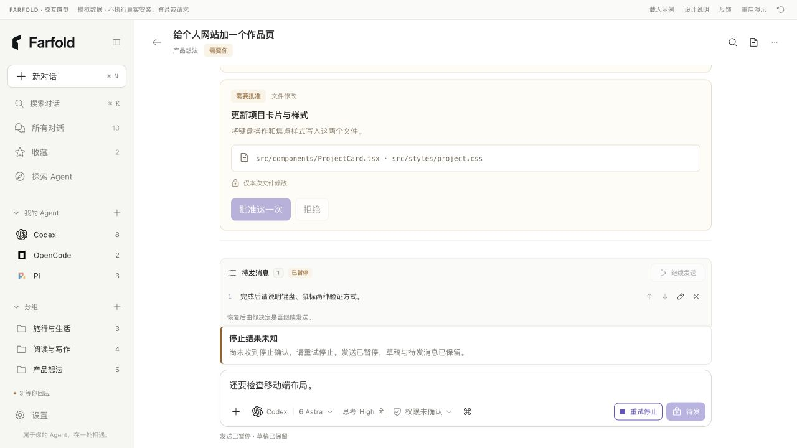
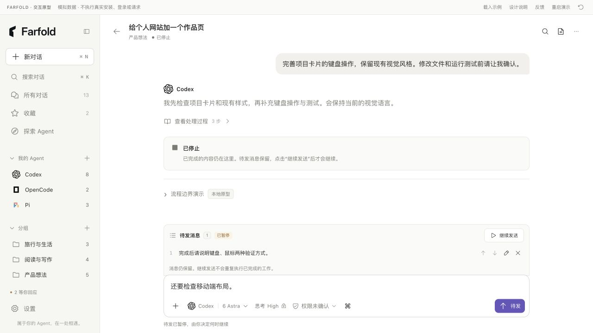
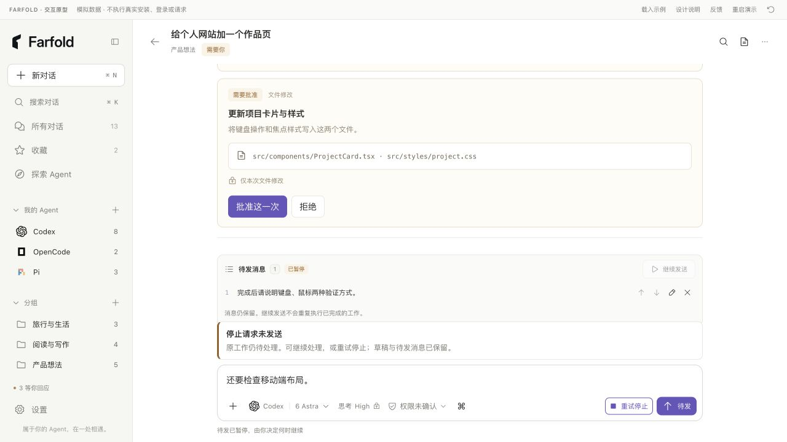
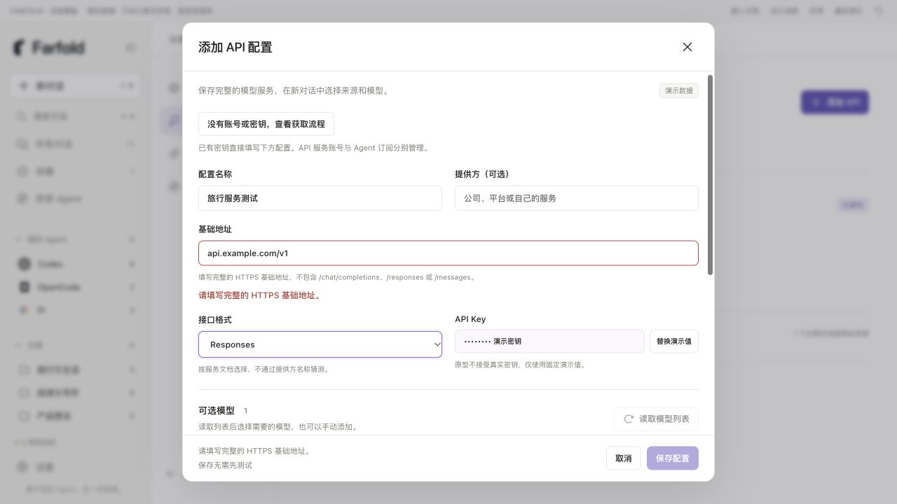
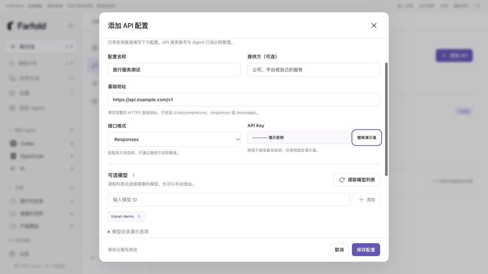

# 两项原型问题修复与复测

日期：2026-09-28。范围：当前 `.design/2026-09-26-agent-access-redesign/workbench/` 原型。未修改正式产品源码、账号、凭据或历史；浏览器操作使用独立的 localhost 演示状态，未重置用户 127.0.0.1 页面。

## 修复结果

1. **停止异常**：将原消息列表顶部的停止反馈移到固定输入区。发送保护继续保留，按钮单独区分等待、未知和发送失败：等待时禁用“停止中”，未知或失败时启用“重试停止”。收到确认后才显示已停止，草稿和待发内容保留、不自动续发。模拟确认按钮归入原有“流程边界演示”。
2. **API 表单**：呈现现有校验给出的地址错误，并把错误说明关联到输入框；保存区显示缺少名称、有效地址、演示密钥或模型等具体条件。修正后清除对应错误，保存仍不要求先测试；地址更改后的密钥确认规则保留。

## 页面复测

- 收起演示工具、停留在输入区，停止等待转为未知后，无需翻到顶部即可看见状态和重试按钮。
- 点击重试进入等待；模拟收到确认后显示已停止，原独立草稿与 1 条待发消息仍在，未自动发送。
- 新一次停止模拟发送失败后显示“停止请求未发送”和可用的重试按钮，原审批仍可处理。
- 地址 `api.example.com/v1` 在字段旁显示错误，并在保存区说明原因；清空后仍有明确提示。
- 改为 `https://api.example.com/v1` 后清除地址错误，保存区改为提示选择当前地址的演示密钥。重新选择后保存可用，成功保存且提示未发送给任何 Agent。

## 截图

## 工程验证

- 停止反馈新增回归先复现 3 项失败，修复后 4 项通过。
- API 表单新增回归先复现 7 项失败，修复后 7 项通过。
- 当前原型完整回归：**478/478 通过**，输出见 [tests.log](tests.log)。
- 原型 Vite 打包通过；仍有单个压缩包超过 500 kB 的提示。
- 本次修改文件的 Prettier 检查通过；独立交叉检查未发现本次停止改动引入的明确问题。

以上是模拟原型与工程检查结果，不代表 `/Applications/Farfold.app` 的真实停止、认证或 API 请求验收。
