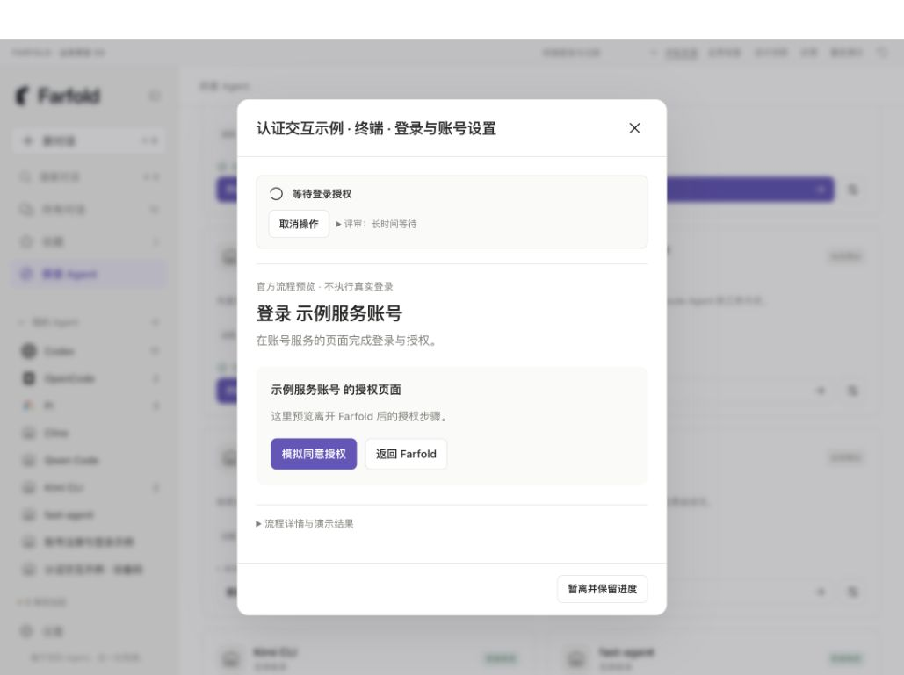
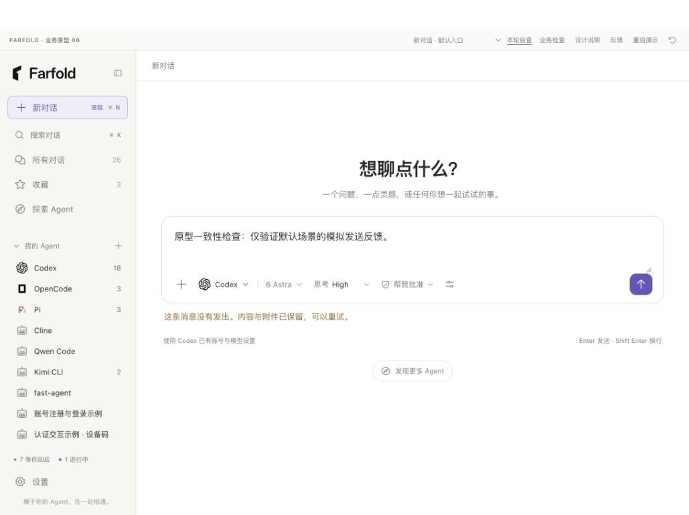
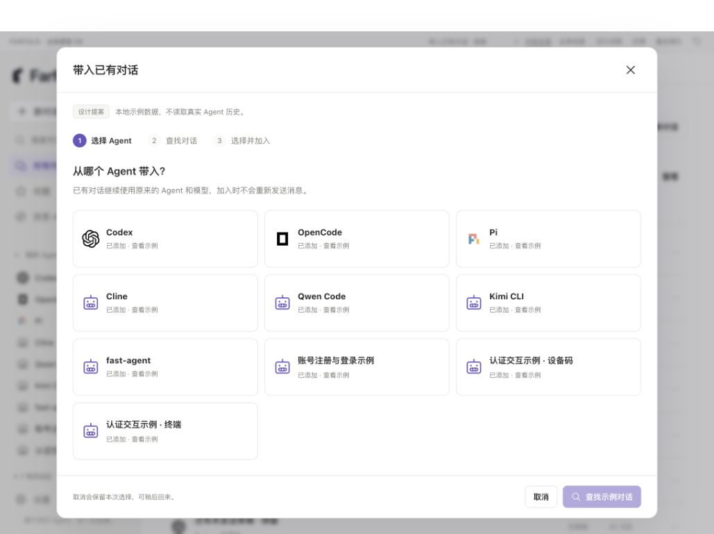

# Farfold 原型一致性检查

检查日期：2026-09-28。对象：[Farfold · 业务原型 06](http://127.0.0.1:8847/)。

## 结论

确认两项场景逻辑问题和一项轻度冗余。已检查的十个 Agent 共用设置框架；没有发现这些 Agent 分别使用互不相干的旧版设置页面。账号方式、安装状态和正在进行的工作会造成合理差异。

用户截图是当前原型的「评审场景」菜单。菜单把日常页面、异常状态、认证演示放在一起；它的选中项不能完整说明当前页面及仍然生效的模拟条件。它不是产品的日常导航。

## 检查范围和方法

- 从可见页面实际操作，保存截图，并比较场景入口与日常入口。没有通过源码推断页面行为。
- 检查 29 个菜单条目中的 28 个落点；未进入「首次打开」。落点检查不等于完整验证每条流程。
- 检查十个 Agent 的管理入口；深入检查 Qwen Code、Cline 和浏览器／设备码／终端认证样例的部分登录、注册、返回和取消路径。
- 实际验证一次模拟发送失败及随后重试成功。其余首次发送变体只检查进入状态，未逐一发送。
- 独立复核「本轮自查」的日期、账号说明和验证边界。
- 本次没有修改原型代码。操作只涉及原型模拟数据；没有执行真实登录、安装程序、保存真实凭据或调用模型。

严重度：S1 阻断，S2 重大，S3 中等，S4 轻度。本次没有在已覆盖路径中确认 S1／S2 问题。

## 确认问题

### F01 · S3 · 终端场景的名称与默认登录路径不一致

**置信度：高。**

复现：

1. 顶部选择「终端登录与注册」。
2. 进入「认证交互示例 · 终端」的账号设置。
3. 选择「登录 示例服务账号」，再选「打开登录页」。

实际：标题仍包含「终端」，正文要求在账号服务页面登录与授权，展示「示例服务账号的授权页面」「模拟同意授权」「返回 Farfold」。这条主路径演示的是浏览器授权。展开更多选项和流程详情，也没有让当前主路径呈现终端交互。

影响：评审者以为自己正在验证终端登录，实际上无法从该路径检查终端输入、等待、退出和返回的体验。名称和内容应能让评审者确定正在检查哪一种方式。

范围：这是场景与默认内容错配，不能由此断言整个原型没有任何终端能力。

证据：[场景落点](21-terminal-scene.png)、[登录初始页](22-terminal-login.png)、[更多选项](53-terminal-options-expanded.png)、[流程详情](54-terminal-flow-details.png)。

### F02 · S3 · 切换场景后，仍生效的模拟失败条件不可见

**置信度：高。**

复现：

1. 选择「首次发送 · 明确失败」。
2. 再切换到「新对话 · 默认入口」。
3. 输入「原型一致性检查：仅验证默认场景的模拟发送反馈。」并发送。
4. 在失败后重试。

实际：顶部已显示默认入口，但首次发送仍按之前的失败条件处理。没有持续提示说明这个条件仍将影响下一次发送。随后重试成功，生成明确标注为示例回复的模拟对话。

影响：同一个默认入口会因评审顺序产生不同结果，评审者难以区分产品逻辑问题和之前设置的演示条件。应持续显示仍生效的演示条件及其作用范围，或在切换时明确说明保留行为。

范围：一次失败随后成功符合「影响下一次发送」的语义。问题是条件不可见，不能报告为失败状态永久残留。

证据：[选择失败场景](42-first-failed.png)、[重试成功](48-default-retry.png)。

### F03 · S4 · 认证样例进入日常列表，产生额外辨认负担

**置信度：高；属于信息组织问题。**

浏览器、设备码和终端演示使用的示例 Agent 会出现在「我的 Agent」侧栏，并与 Codex、OpenCode 等一起出现在「带入已有对话」的 Agent 选择列表。它们和普通条目使用同一层级、相似卡片结构。

影响：完成认证场景评审后，继续检查接入和历史入口时，需要反复识别哪些是演示辅助条目；场景越多，列表越长。示例身份可保留，但评审辅助条目与日常选择应更容易区分。

范围：这些条目名称包含「示例」，页面也说明使用模拟数据；没有证据表明它们冒充真实账号。保留演示状态本身不构成错误。

## 逐项回答用户关心的问题

### 1. 不同 Agent 的接入界面是否一致？——框架基本一致

十个 Agent 的管理入口使用同一套「账号与服务／模型／程序」页签。以下记录的是本次打开时的模拟状态，不是官方接入能力认证。

| Agent | 实际观察 | 判断 |
| --- | --- | --- |
| Codex、OpenCode | 可见本机配置与 API 服务选择；正在进行的工作阻止部分账号变更 | 同一框架，状态差异有提示 |
| Pi | 提供登录设置入口，部分操作受正在进行的工作限制 | 同一框架，登录方式不同 |
| Cline | 登录或配置服务；可选账号提供方；继续登录时需先确认程序 | 同一框架，准备步骤有差异 |
| Qwen Code | 服务配置入口；外部步骤返回后保留未完成状态 | 同一框架，配置方式不同 |
| Kimi CLI | 账号变更受工作状态限制；模型需要确认 | 同一框架，准备状态不同 |
| fast-agent | 账号方式选择和执行登录动作分开 | 未见结构冲突 |
| Claude Agent、Gemini CLI、goose | 尚未发现程序，先进入程序准备状态 | 三者一致 |

证据：[Codex](05-codex-manage.png)、[OpenCode](06-manage-OpenCode.png)、[Pi](06-manage-Pi.png)、[Cline](06-manage-Cline.png)、[Qwen Code](06-manage-Qwen-Code.png)、[Kimi CLI](14-manage-Kimi-CLI.png)、[fast-agent](14-manage-fast-agent.png)、[Claude Agent](14-manage-Claude-Agent.png)、[Gemini CLI](14-manage-Gemini-CLI.png)、[goose](14-manage-goose.png)。

同一未准备好的 Claude Agent，从「准备使用」进入「连接程序 → 使用方式 → 确认使用」向导，从管理按钮进入三页签设置。这是首次准备与日常管理两种任务入口；本轮未发现它们代表两套冲突的旧界面。[准备向导](15-claude-prepare.png)

### 2. 登录与注册逻辑是否一致？——共同层次成立，终端样例有错配

- Cline 注册先选择账号提供方，返回登录回到该 Agent 的账号设置。
- Qwen 外部配置返回后明确提示尚未收到完成结果；可继续原流程，也可取消。取消确认后原程序和输入保留。
- 注册步骤返回后显示「注册结果待确认」，还需要「我已注册，继续登录」，没有把普通返回当作登录成功。
- 模拟登录页未打开时，出现重新打开和取消入口。
- F01 是已确认的主要不一致。其他账号按钮不同，不能仅凭外观差异认定逻辑错误。

证据：[Cline 注册](10-cline-register.png)、[返回登录](11-cline-return-login.png)、[Qwen 返回](09-qwen-return.png)、[注册返回待确认](58-registration-return.png)、[登录页打开失败](55-login-open-failed.png)。

### 3. 截图菜单与 HTML 正常点击的页面是否一致？——已做配对的页面一致

| 对照入口 | 本次结果 | 截图 |
| --- | --- | --- |
| 侧栏「探索 Agent」／顶部「挑选与接入 Agent」 | 同一目录页面 | [正常入口](04-explore-directory.png)、[场景入口](16-scene-agent-explore.png) |
| 「所有对话 → 项目卡片交互审阅」／顶部代码审阅场景 | 同一对话、三条审阅结果和文件内容区 | [正常入口](60-normal-code-route.png)、[场景入口](24-code.png) |
| 「所有对话 → 周末小计划页面」／顶部网页预览场景及正文打开预览 | 同一对话和「给周末留一点空白」页面 | [正常入口](59-normal-web-route.png)、[正文打开](51-web-preview-reopen.png) |

顶部选中项在正常导航后仍可能保留此前选择，因此它不能当作当前页面标题。已配对的结果不能推广成所有 29 个入口都完整一致。

### 4. 是否有旧内容？——有历史报告，未确认废弃页面仍在使用

- 「旧记录缺少选择」「历史内容恢复」「停止未知」是为检查异常状态而提供的场景。名称中的「旧记录」不是该页面过时的证据。
- 「本轮自查」打开的是明确标注 **2026.09.27** 的静态报告。它包含当时的检查声明和实现边界；本轮未重跑其中的 387/387 检查。
- 该报告明确注明模拟、未真实登录和执行模型请求、未改正式应用、未完成真实产品验收。其账号段没有宣称终端专项已验证正确，与本次 F01 不构成直接的历史声明矛盾。
- 未发现足够证据认定截图中的菜单整批属于旧版。菜单的分类和有效状态呈现仍需改善，见 F02、F03。

证据：[旧记录场景](31-old-choice.png)、[设计说明](49-design-explanation.png)、[历史报告日期](audit-reference-01-header.png)、[账号说明](audit-reference-02-account.png)、[报告验证边界](audit-reference-03-limits.png)。

## 覆盖清单

| 检查步骤 | 健康状态 | 覆盖程度 |
| --- | --- | --- |
| 1. 日常导航与场景入口 | 部分需改善 | 28/29 落点；探索、代码和网页做配对；有效条件存在 F02 |
| 2. Agent 接入和管理 | 已检查部分基本一致 | 十个管理入口；Claude 准备向导；未真实安装 |
| 3. 登录、注册和返回 | 需改善 | 多条模拟返回、取消及注册路径；终端样例存在 F01 |
| 4. 对话内容与异常状态 | 落点可进入 | 代码、网页、文稿、输出、确认、历史恢复、旧记录、停止未知、文件结果、旅行、写作 |
| 5. 草稿、附件、归档和筛选 | 部分检查 | 已查看场景状态；未执行完整重启恢复验收 |
| 6. API、带入对话、LifeModel | 部分检查 | 已查看当前页面和声明边界；带入对话列表存在 F03 |
| 7. 首次发送结果 | 部分检查 | 五个变体落点；明确失败后切换默认并发送、重试已测；其余未发送 |
| 8. 历史说明 | 边界已标明 | 阅读可见报告日期、账号说明和限制；未据此认可历史测试结论 |

## 不作为确认问题的观察

- 初次网页预览曾出现空白；从正文重新打开以及从所有对话进入后，已实际显示网页。没有稳定复现持续空白，本报告不把它计为确定缺陷。
- 操作确认场景的对话标题与卡片中的子任务名称不同，可以属于同一个工作；证据不足以认定旧内容拼接。
- Cline 多一步程序选择、不同 Agent 登录按钮不同，均可能来自当前状态与接入方式。没有要求所有 Agent 使用相同认证方法。
- 本次工具点击曾产生偏移；后续改用键盘激活并重新观察。该工具行为未计入原型缺陷。02、03、52 截图不用于支持最终问题。

## 本次留下的原型状态

评审场景生成了一些明确标注的示例记录，并新增一条名为「原型一致性检查：仅验证默认场景的模拟发送反馈。」的模拟对话，用于验证失败后重试。未重置浏览器演示数据，避免清除之前的评审工作。返回与取消操作只针对本次打开的认证演示。

建议先处理 F01 和 F02，再整理评审样例的入口与分组。它们直接影响下一轮评审能否准确判断页面和行为。
