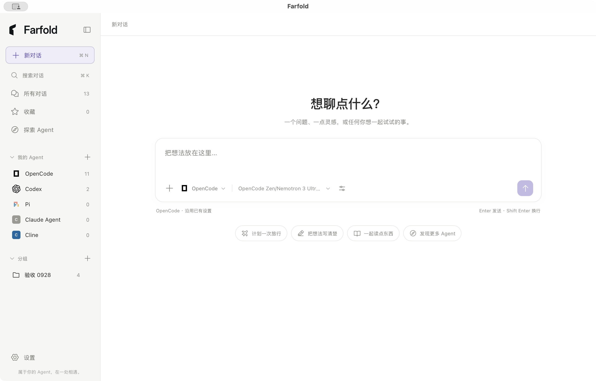
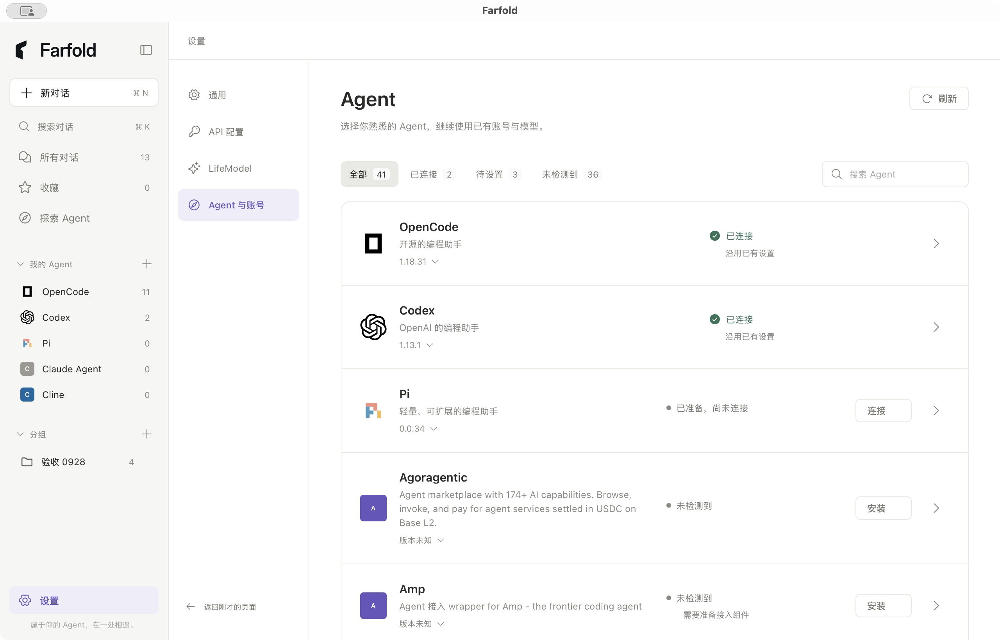
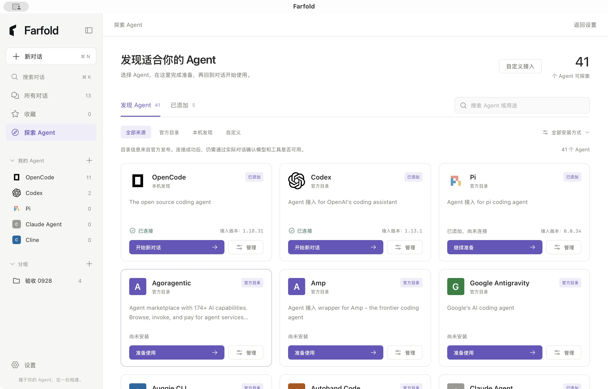

# 原型与正式版差距只读评估

2026-09-28。用户要求不做代码更改，只判断当前 Farfold 与认可原型的差距。本次仅导航、截图和读取已有状态记录；未发送模型请求、登录、修改设置或生产代码。正式应用最后返回原来的 Agent 与账号设置页。

当前现场覆盖三组页面。原型浏览器视口1280×820，正式窗口1280×820（Retina截图2560×1640）；原型顶部演示栏与正式窗口标题栏不同，数据与接入状态也不同，不进行像素相似率计算。原型早期截取01-prototype-new.jpg被面板裁切，01-prototype-new.png的fullPage输出比例异常，均不作为评估证据。

## 1. 新对话：主体接近

侧栏、标题、输入框位置与宽度、紫色强调、建议入口及整体留白接近。正式版已选OpenCode，原型尚未选择Agent，按钮和说明差异属于状态差异，不能算还原缺陷。

| 原型                                         | 当前正式版                          |
| -------------------------------------------- | ----------------------------------- |
|  |  |

## 2. 设置中的 Agent 与账号：明显的职责差距

同样从设置进入：原型切到统一探索页的“我的 Agent”，标题为“管理已添加的 Agent”；正式版仍在独立的设置列表中，默认“全部41”，包含未检测到条目和安装按钮。原型要求的日常管理与发现安装分工没有完整带入。此差距不由真实Agent能力限制导致。

| 原型                                                    | 当前正式版                                            |
| ------------------------------------------------------- | ----------------------------------------------------- |
|  |  |

## 3. 探索 Agent：外形接近，选择逻辑和文案有明显差异

均有搜索、卡片、准备/管理入口。但原型按编程、自动化、研究、轻量帮助用户选择用途；正式版按官方目录、本机发现、自定义、安装方式筛选，强化了来源与安装信息。正式版大量保留英文目录说明、接入版本，部分文字呈中英文拼接，例如“Agent 接入 for OpenAI's coding assistant”。目录来自真实服务是合理差异，但不能等同已完成原型的用途说明与信息层次。

| 原型                                  | 当前正式版                            |
| ------------------------------------- | ------------------------------------- |
|  |  |

## 真实能力与证据边界

下列判断来自本次读取的状态页与上一轮安装记录，不冒充本次重新测试：准备暂离、原稿返回、模型/思考保持、双路任务、单次批准、停止和冷恢复已有真实证据；新账号、新密钥交付/轮换、复杂异常与全量键盘/性能仍缺完整覆盖。API来源补Agent登录当前没有可用生产路径；Pi版本、Claude账号和Big Pickle限流按各自条件开放。未验证不等于已经证明不可用。

本次没有覆盖完整对话、产物、历史、API、准备向导及深色/窄窗全部状态；不输出全产品百分比、像素相似度、完整可访问性或可靠性通过结论。截图也不能证明权限效果、密钥交付或异常恢复。

总体判断：视觉框架差距较小，页面职责与产品语言仍有明显差距，完整接入和持续使用的可靠性尚未收口。当前是能实际工作的阶段版本，不能将“部分功能与工程检查通过”称作“认可原型已经完整落地”。下一阶段应先纠正页面职责和用户操作路径，再进行外观细节与完整真实旅程的联合验收。
