# 两项可靠性修复与整体 UI/UX 复核

日期：2026-10-08。源码起点 `d2fdda6f`，本目录随修复提交；正式应用仍为 `/Applications/Farfold.app`，0.1.7 arm64，来源 `d7e454ac`，程序 SHA256 `f921489355dc8af3d420978268c02b6a5521d89a681b5bb1327a6bdbf30142ca`。源码修复与安装版界面观察是两组证据。

## 修复与验证

### 清除后旧数据回写

根因：清除只删持久数据，前端草稿等缓存仍存在；正常退出保存及后台旧快照可以重新写回。清除期间外层设置弹窗也可关闭。

- 清除事务与同连接禁写在同一数据库锁内完成，旧克隆连接也不能恢复草稿、设置或登记。新进程重新打开空库后正常可写。
- 成功清除后不走旧草稿保存流程，保留活动互斥直到进程退出并请求重新打开应用。清除期间拦截旧退出确认；外层弹窗、底部按钮和重复清除均锁住。
- 凭据修改的后台工作持有活动许可，调用方取消不提前释放，避免密钥写入与清除交错。目录清除失败时保留元数据及重试依据，继续明确报告部分失败。
- 临时数据库回归覆盖旧草稿/登记回写拒绝、新连接可写、目录部分失败保留元数据、旧退出 token、失败释放退出保护、重复点击和弹窗 busy。未对用户数据执行清除。

### 相同设置再开的服务来源

根因：按凭据 ID 找到当前 revision 后直接采用，未比较旧对话的服务身份；同一条 API 配置改地址或接口类型会被当成原来源。

- 后端向非秘密列表提供规范化地址与 API 类型的指纹，和历史身份采用同一算法，不读取或暴露密钥。
- 仅指纹匹配、服务完整且未删除、原模型仍存在时采用当前 revision。同来源改名、密钥轮换可继续沿用。
- 来源变化、无旧身份、服务删除/不完整或模型移除时保留旧选择且 revision 留空，走已有重新选择机制。
- 三个 App 实际事件入口回归：对话库再开、对话菜单再开、从消息新开；确认不直接打开/发送，并保留工作位置、思考设置与消息草稿。

两项均先补失败回归再修复。独立审查分别覆盖服务身份和清除/退出/并发边界，无新增阻断。七项检查结果见 [checks.json](checks.json)：前端 209 文件 / 2450 项；Rust 1039 通过、4 原忽略。构建保留现有大 chunk 提示；Rust 测试仍有 archive.rs 测试内未用 import 的原有 warning。没有把自动化测试当作已安装清除成功。

## 整体判断

当前已有统一工作台的框架：固定侧栏、通用输入区、统一 Agent 选择、消息和内容分栏、集中设置。阅读正文、状态文字与能力边界说明总体可理解。

日常使用的主次关系仍需要系统调整。新建页把消息输入压成窄卡；管理页优先邀请开始新对话；恢复权限把下一步藏在其他控件中；设置和网页面板又同时展开很多低频说明。用户需要花额外精力判断“我在哪里、现在能做什么、接下来点哪里”。建议现在开始一轮围绕日常任务的 UI/UX 改版，与停止/恢复的可靠性工作并行。

以下高/中优先级是本轮体验建议，未作为已确认功能故障或新验收门槛。

| 优先级 | 观察与影响                                                                                                                              | 建议方向                                                                                                   | 证据                                          |
| ------ | --------------------------------------------------------------------------------------------------------------------------------------- | ---------------------------------------------------------------------------------------------------------- | --------------------------------------------- |
| 高     | 新建输入卡约占主区三成宽，Agent/模型、思考、权限、命令分成多行；同一宽窗已有对话输入区明显更宽。配置比写消息更突出                      | 新建和已有对话共用宽度与布局规则；常用项紧凑一行，低频设置按需展开；空白区提供简短起点                     | 01、08                                        |
| 高     | 设置的“Agent 与账号”跳入高亮“探索 Agent”的页面；标题写管理，卡片主按钮仍是“开始新对话”，管理仅小图标                                    | 明确发现、管理、开始工作三种任务；管理入口默认显示当前账号/服务/模型与修改动作                             | 03、14                                        |
| 高     | Codex 标“可以使用”，管理窗仍是程序→账号与服务→模型的向导，底部“暂时返回/使用已有设置继续”；本轮 AX 还显示模型页禁用且提示先选择接入方式 | 首次准备和日常管理采用不同信息层级；已有状态先可见，再按具体修改进入步骤。禁用原因与当前状态一致           | 05、06；禁用结论来自本轮 AX，不由灰色截图推断 |
| 高     | 历史载入后“继续发送前，请重新确认…权限”只有文字；实际入口在输入区权限下拉。“等你回应”同时承担恢复确认提示                               | 在提示旁提供明确的重新确认入口，并解释本次需要确认什么；区分恢复待确认和 Agent 正在提问                    | 08、10；未点击批准                            |
| 中     | 最近列表多条 hello 靠 Logo 区分；最近八条把我的 Agent 和分组推到下方；对话库才补上 Agent 与位置                                         | 最近行增加必要的来源辅助信息，压缩固定标题和留白；让待回应/新回复更容易定位                                | 01、07、08                                    |
| 中     | 内容栏命令输出直接主显工具名、原始 JSON 和重复空行，占近半工作区；打开后当前末段一度不在可见区域                                        | 默认提供可读结果摘要与错误原因，原文保留可展开；同时核查分栏宽度和阅读位置保持。单次重排不直接判定锚点缺陷 | 09                                            |
| 中     | 网页空态同时出现地址、权限、来源、项目网页、HTML 和说明；通用页大主题卡和多层解释消耗首屏；API 服务条目纵向较松                         | 建立一致的紧凑行、解释折叠与状态样式，先突出当前操作；需要时再展示细节                                     | 10、11、13                                    |
| 中     | “新会话/新对话”、Agent 原始英文描述和技术原名混杂；LifeModel 明确未启用，但入口未标记                                                   | 统一 Farfold 自有术语，原始能力描述保留可追溯层。按现有契约保留 LifeModel 页，可给入口加未启用标记         | 01、05、09、12                                |

值得保留：灰白底色和圆角语言已较一致；主导航、新建和搜索快捷键可见；正文与工具过程分层；网页不会自动交给 Agent、API 保存与使用分开、LifeModel 未启用的边界说明明确。Agent 选择和详情弹窗可用 Escape 返回，未观察到本轮已走路径中的关闭失败。

## 覆盖步骤和截图

全部截图来自本次正式安装版操作，先保存再核图，无重绘或用原型替代。窗口为 1280×820 点，截图 2560×1640，纸白主题。下表“完成”仅指对应界面已到达并观察；不代表其中按钮的实际任务能力已验收。

| 步骤 | 实际路径                           | 状态与范围                                   |
| ---- | ---------------------------------- | -------------------------------------------- |
| 01   | 打开原有新对话草稿                 | 完成，观察初始输入、位置及选择，不发送       |
| 02   | 输入区打开 Agent 选择器，再 Escape | 完成，只看列表，不更换 Agent                 |
| 03   | 探索 Agent                         | 完成，目录及筛选入口，不执行发现/安装        |
| 04   | Codex 详情，再关闭                 | 完成，能力声明和关闭路径                     |
| 05   | Codex 管理→账号与服务              | 完成，已有状态与向导；不登录或继续授权       |
| 06   | 程序页，再 Escape                  | 完成，程序和移除入口；不移除                 |
| 07   | 所有对话                           | 完成，107 条下列表、筛选和整理入口           |
| 08   | 打开已有 Codex 测试对话            | 完成，自动载入历史并出现权限待确认；未续问   |
| 09   | 对话内容→文件与输出                | 完成，日志和分栏呈现；未复制/导出            |
| 10   | 内容→网页                          | 完成，仅空态；未打开网址或授予读取权限       |
| 11   | 设置→通用                          | 完成，只观察；未改主题/通知/归档配置         |
| 12   | 设置→LifeModel                     | 完成，未启用状态                             |
| 13   | 设置→API 配置                      | 完成，列表元数据；未编辑/测试/删除或读取密钥 |
| 14   | 设置→Agent 与账号                  | 完成，观察导航跳转；结束回到所有对话         |

未覆盖：深色及窄窗口、完整键盘/读屏和对比度测量、真实审批快捷键、停止/恢复续答、发送/重发、文件导出产物、实际网页共享/截图、通知送达、真实数据清除与新来源重新选择、29 家八项完整标准及 Windows。没有以这些页面截图追认旧功能结果。

### 01 新建对话

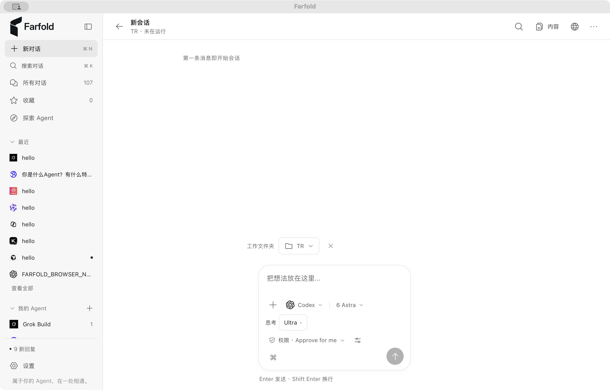

### 02 Agent 选择

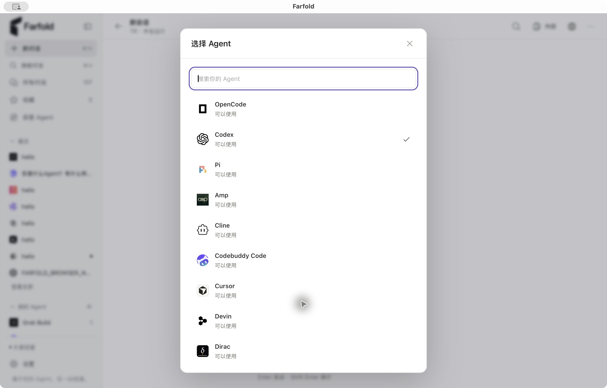

### 03 探索目录

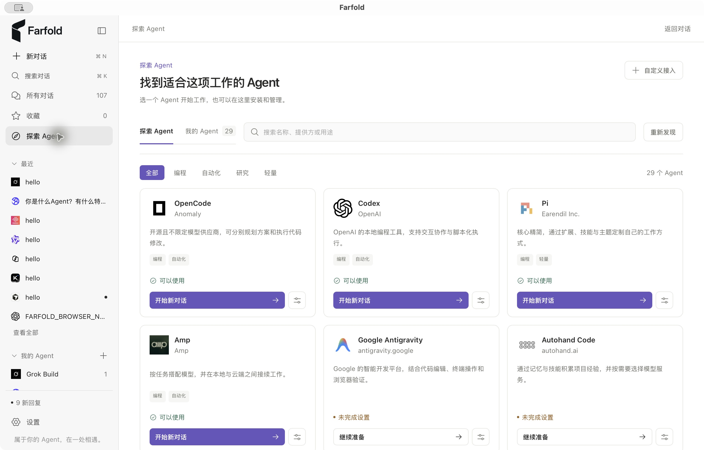

### 04 Agent 详情

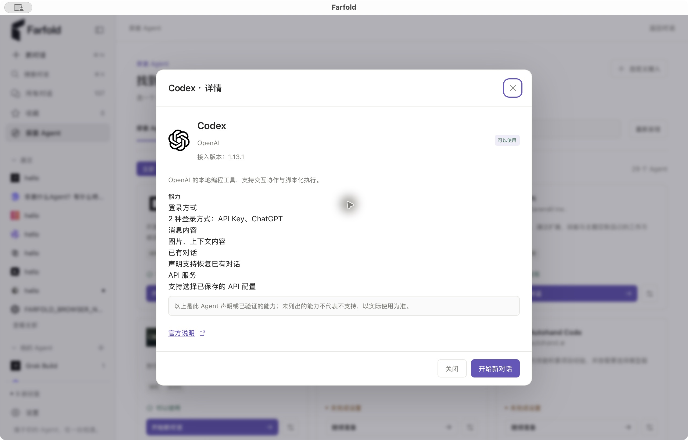

### 05 账号与服务

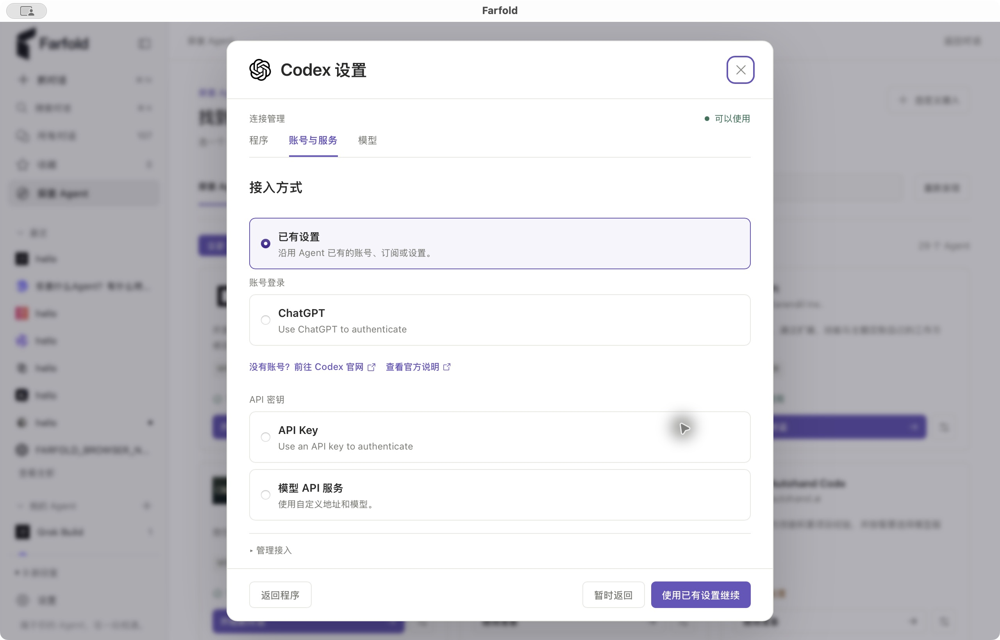

### 06 程序管理

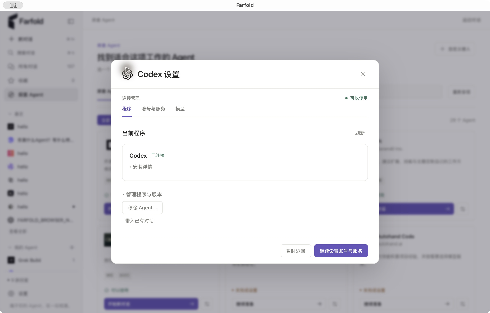

### 07 对话库

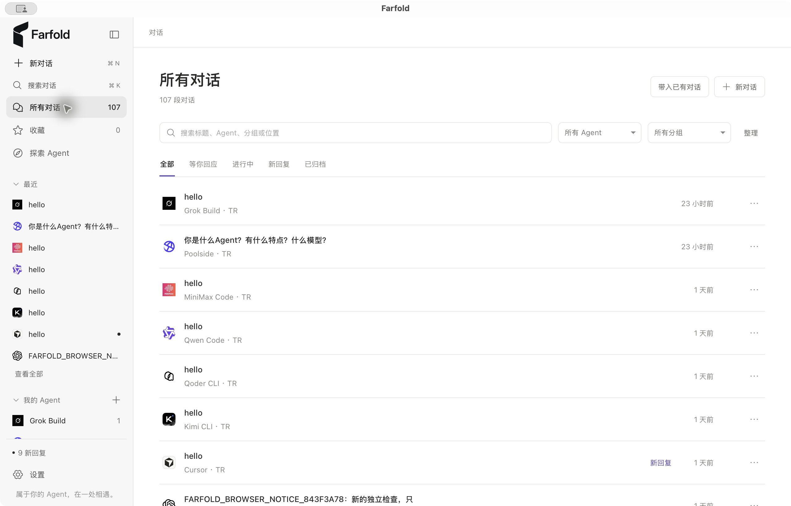

### 08 已有对话

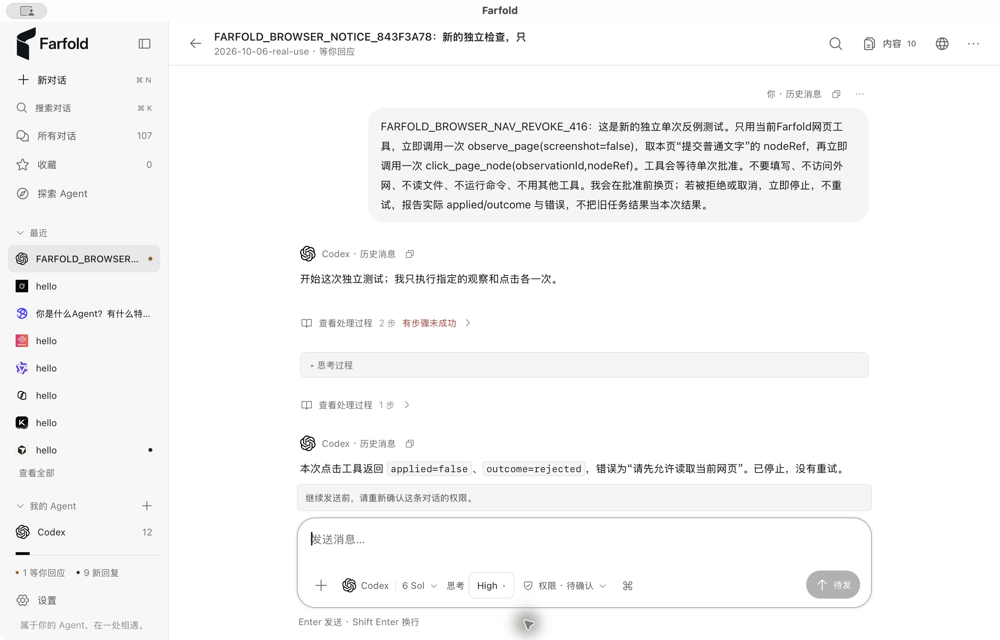

### 09 内容栏

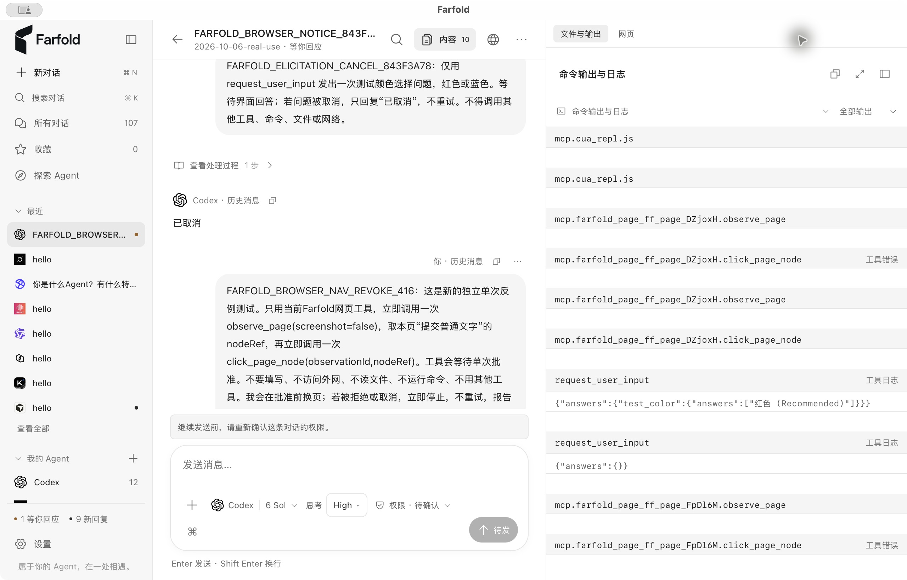

### 10 网页空态

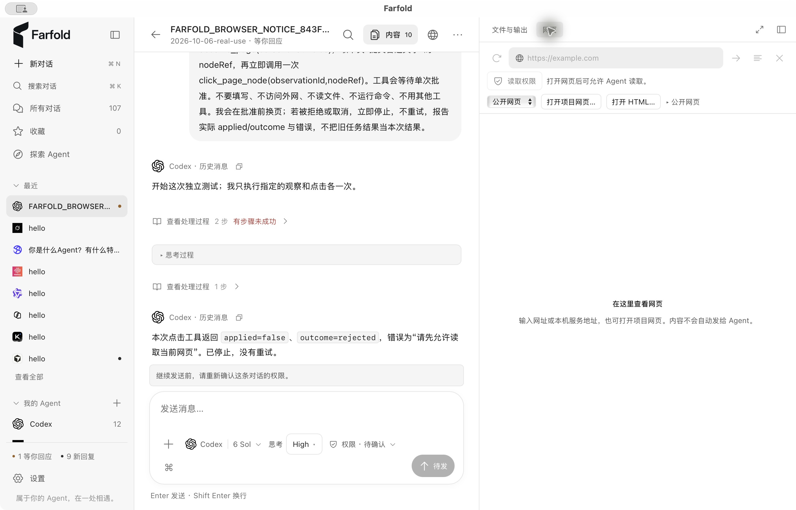

### 11 通用设置

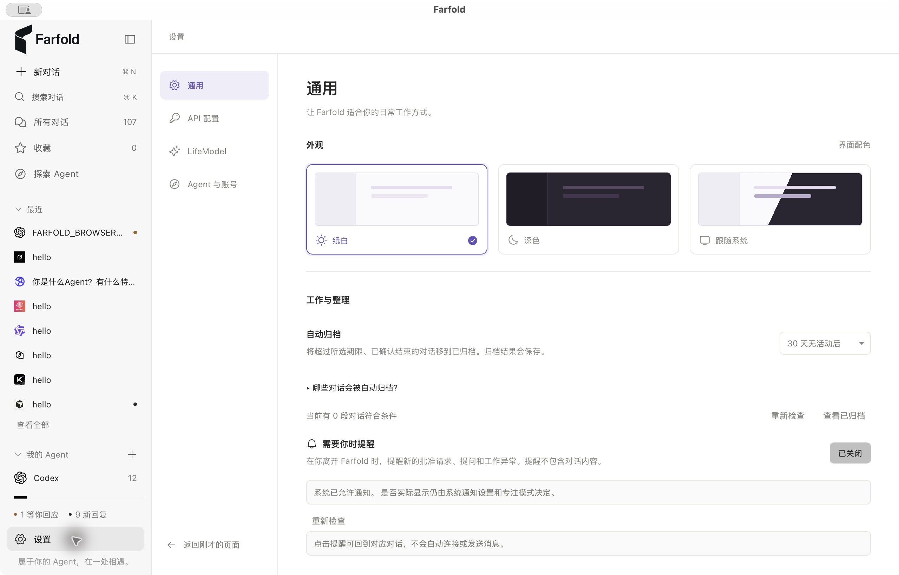

### 12 LifeModel

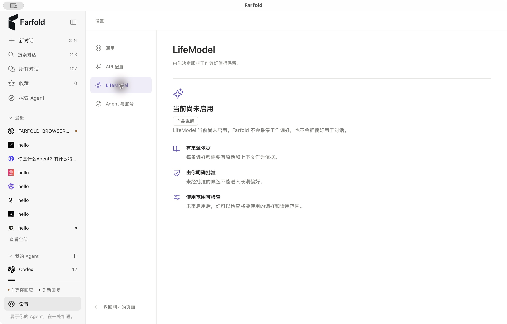

### 13 API 配置

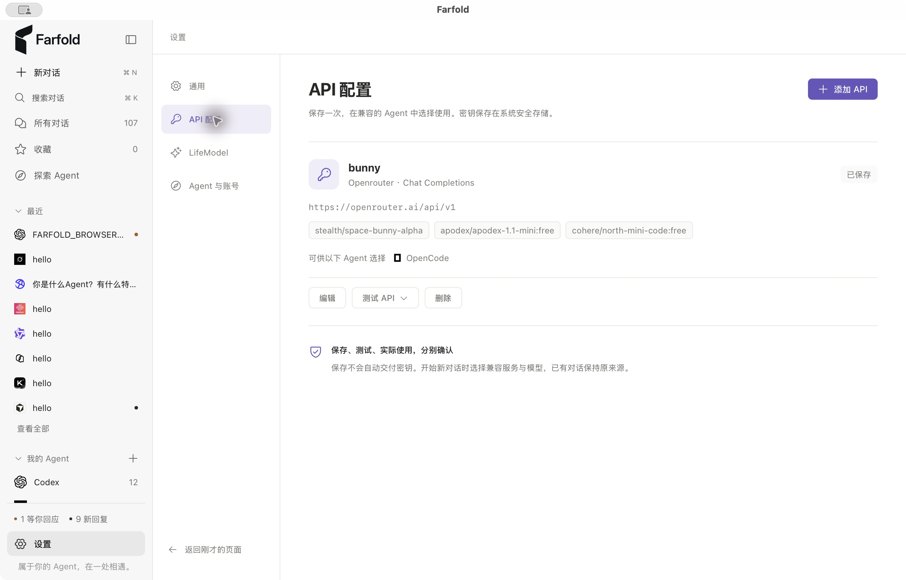

### 14 Agent 与账号导航

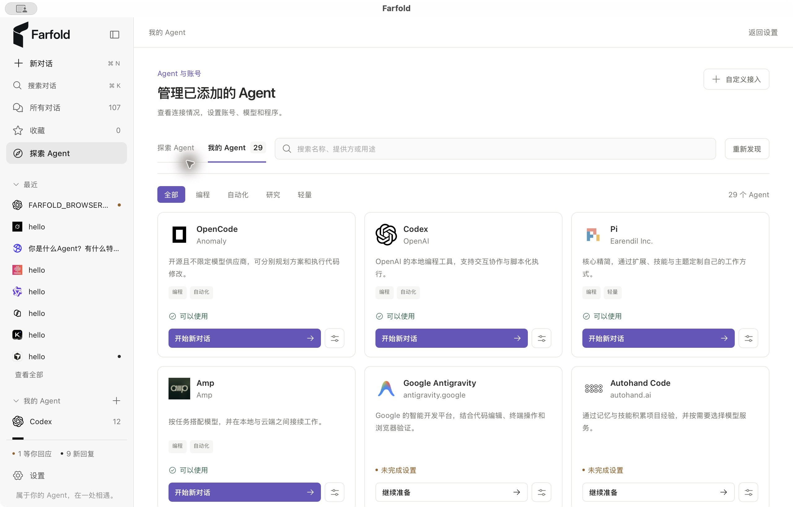
