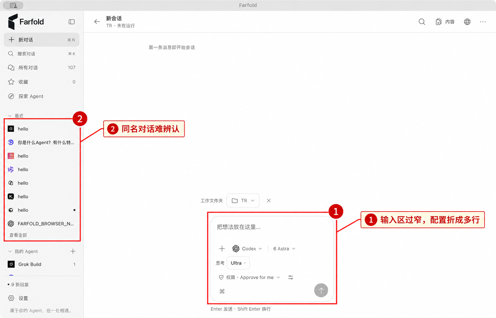
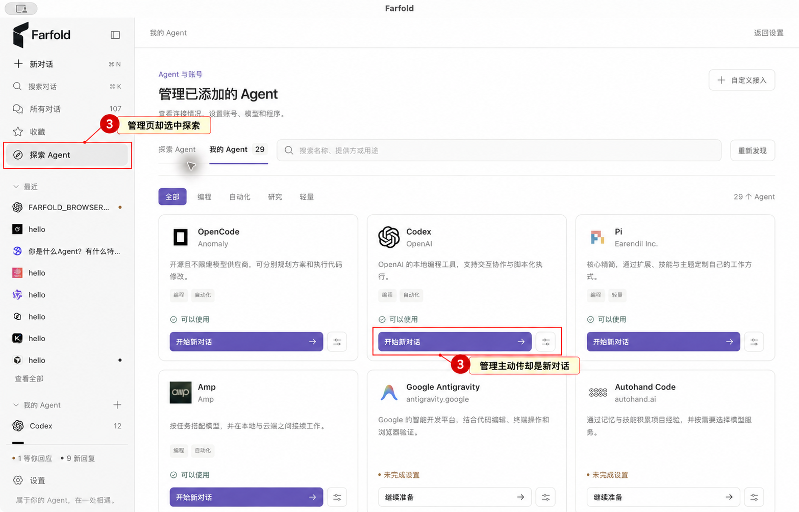
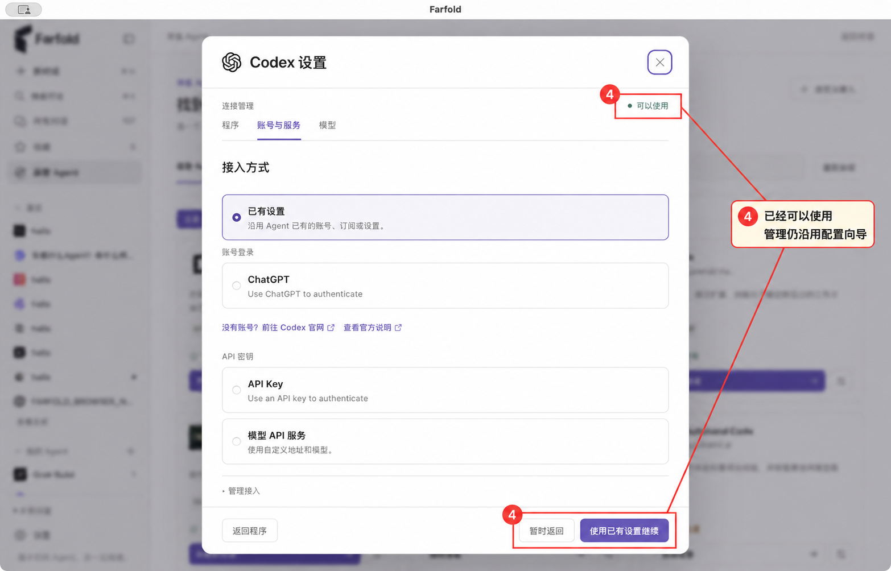
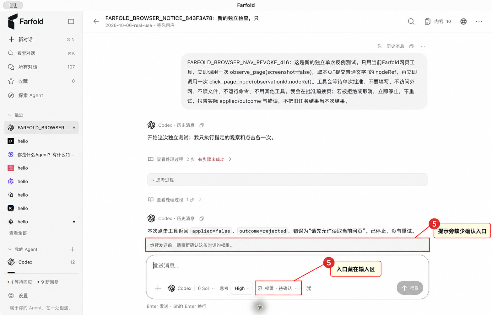
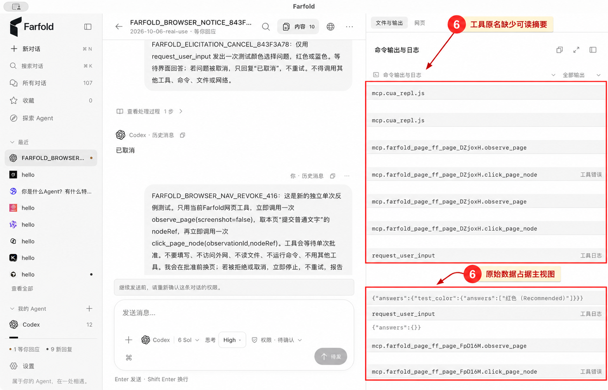
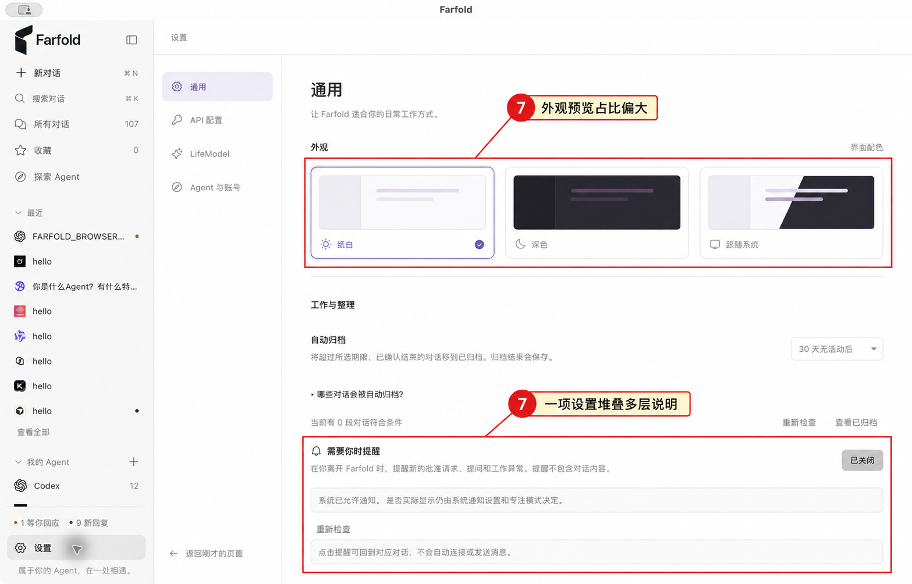

# UI/UX 问题标注

在 6 张截图副本上标出 7 类问题。红框圈定讨论位置，相同编号的两个框需要配对查看。这里包含交互发现性和布局优化建议，不表示每一处都是功能故障。

标注副本由内置 imagegen 生成，已逐张目视核对框选位置与说明。生成副本会缩放并可能改变小字细节，精确界面文字与状态仍以每张附带的原始截图为准；原图未改动。工具提示词保存在 [prompts.json](prompts.json)。

## 1–2 新对话和侧栏

1. 输入区窄，Agent、模型、思考和权限折成多行。
2. 最近对话同名时，主要靠 Logo 辨认。

[查看原图](../screenshots/01-new-conversation.png)

## 3 管理页面的导航与主动作

管理页高亮“探索 Agent”，卡片最突出的动作仍是“开始新对话”，管理入口较弱。

[查看原图](../screenshots/14-agent-account-navigation.png)

## 4 已可用 Agent 仍沿用配置向导

上方已标“可以使用”，底部仍引导“使用已有设置继续”。日常管理的当前状态与修改入口应更直接。

[查看原图](../screenshots/05-agent-settings.png)

## 5 恢复提示与实际入口分离

提示要求确认权限，却没有就地按钮；实际入口在下方输入区的权限下拉菜单。

[查看原图](../screenshots/08-conversation.png)

## 6 日志区缺少可读结果层

工具原名、重复记录和 JSON 直接占据主要区域，需要先有动作和结果摘要。

[查看原图](../screenshots/09-content-panel.png)

## 7 设置页的信息密度

外观预览占比偏大；通知一项同时展示多层说明。属于布局与信息层级建议。

[查看原图](../screenshots/11-general-settings.png)
