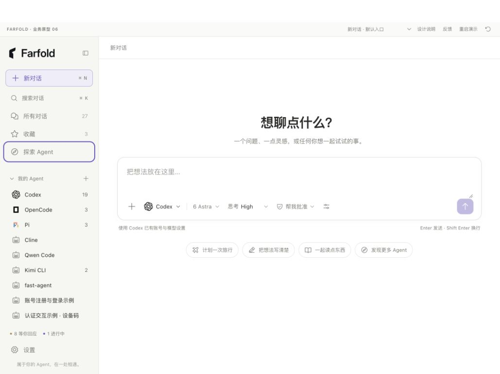

# 原型清理记录

日期：2026-09-28。授权：用户要求删除过去旧内容，只保留最新原型。

## 落地前最终复核（2026-09-28，用户认可当前原型后）

**当前只维护一份原型。** `.design/` 仅保留当前目录和入口说明，唯一源 HTML 通过 `main.jsx` 加载 `AppV2.jsx`；8847 预览进程指向这份目录。旧版本目录、旧场景下拉菜单和第二套接入入口未重新混入。以下为本次核查；后文保留早先清理的范围与结果。

本次进一步清理：

- 12 个 CSS 文件中已无当前页面引用的旧详情、接入、账号交接、注册步骤、设置和对话标题样式：2,217 行、439 条完整规则、475 个选择器分支。混合规则保留仍被使用的分支；追加 9 文件中 1,030 个保留选择器的声明前后一致。逐项删除范围与证据限制见 [样式清理证明](final-style-cleanup.json)。
- 删除 `main.jsx` 中重复的 `v2.css` 导入，保留 `AppV2.jsx` 中的唯一导入；删除 `.design/.DS_Store`。
- 清理自动归档页面“规则提案／正式产品规则待本轮评审”的过时表述，保留浏览器演示范围说明。
- 将活动计划里重复的 9 月 27 日“当前安装”说明替换为本轮停点与实施顺序；状态页明确区分历史安装、当前原型和仍待落地的差距。原始验收证据保留。

核查结果：

- 106 个当前 JS/JSX/CSS 文件均可从入口到达；无缺失相对导入、整文件重复或超过 1,500 行的源文件。五个公开 SVG 仍有当前引用。生产源码与配置未导入原型。
- 11 份活动文档的本地文件链接目标全部存在；检查范围不包含所有标题锚点与外部网站。
- [原型回归](final-tests.tap) 478/478 通过。归档文案调整后，原测试中要求“规则提案”的旧断言也已改为验证演示范围，随后再次运行完整回归；[首次旧断言失败](stale-copy-assertion-initial-failure.tap) 保留诊断记录。15 个修改的源码、测试与样式文件格式检查通过。[最终打包](final-build.log) 通过，仍有原有的脚本体积提示，不据此认定性能达标。
- 浏览器抽验目录、三步接入、已完成 Agent 管理、通用设置、LifeModel 说明及 API 错误反馈；900×620 下 API 表单可滚动、页脚可见。临时检查页已关闭、窗口尺寸已恢复，没有重置用户正在使用的预览数据。截图见 [final-screenshots](final-screenshots)。
- 清理前记录的 267 个生产文件变化为零；最近候选五记录的 272 个生产文件仍全部匹配，当前安装主程序摘要也与其一致。本轮只核验身份，没有更新正式应用或重新执行真实 Agent／安装版旅程。

保留的 `data.js` 是当前样例数据依赖，`prototype-migrations.js` 用于清除旧浏览器模拟状态，旧数据形状的测试样本用于防止回退；它们都在当前引用链中，不是第二套旧界面。`dist/` 为当前源文件重新生成的输出。历史真实接入、安装和恢复证据继续保留。

完整结果见 [final-hygiene.json](final-hygiene.json)；[认可原型文件摘要](implementation-baseline.json) 固定本次设计起点，不复制另一份原型。下一轮沿用 [唯一活动计划 §00.14.7](../../../plans/runtime-neutral-lifemodel.md)，从已有生产实现增量补齐接入、停止反馈与 API 校验，再完成全产品和真实安装验收。原型样例不能作为正式接入能力证明。

## 结果

唯一原型为 [当前工作台](../../../.design/2026-09-26-agent-access-redesign/workbench/README.md)，[本地预览](http://127.0.0.1:8847/)。

- 删除 7 个旧原型目录：9 月 16、22、23、24 日的设计版本及两份历史设计导出。
- 删除上层旧 8846 原型、旧资源、旧分析文档；该层只保留当前入口 README 和 workbench。
- 删除当前目录中五组历史报告目录、十份旧报告，以及旧打包输出；打包输出随后由当前源文件重新生成。
- 删除十二个不再使用的界面、样式、数据和资源文件。移除顶部历史自查及重复业务检查入口。
- 当前接入、工作台、思考深度、权限和发送管理规则合并为一份 README，同步产品与开发文档的入口定位。
- 没有保存旧原型备份副本；本记录只有路径、摘要、删除与验证结果。

精确目录和文件清单见 [deletions.json](deletions.json)；源码的删除与改动见 [verification.json](verification.json)。45 个精确清理目标原含 11,995 个文件，包含旧版本的独立依赖和生成输出；这不是业务文件数量，也不是实际释放磁盘空间的测量。

## 保留与范围

当前使用的源文件、测试和资源保留。另核对两份 2026-09-26 终端旧视图及样式，确认当前入口和全部测试均不使用后删除；当前实际使用的终端状态逻辑和测试保留。

对 270 个正式产品源文件、资源和关键配置做清理前后 SHA-256 核对，变化为零。没有操作正式应用、账号凭据或用户历史目录。真实 Agent、安装验收和恢复材料所在的 `docs/evidence/`、`docs/archive/design-qa/` 保留，历史引用不冒充当前导航。

浏览器没有重置演示数据或删除此前反馈。本次只刷新，并打开当前探索 Agent、网页预览和默认新对话页面。

## 验证

- [当前原型测试](tests.tap)：402/402 通过，无失败、取消或跳过。
- [当前原型打包](build.log)：通过；保留原有的单个脚本超过 500 kB 提示，不据此宣称性能已验收。
- 独立核查相对导入、静态资源/入口路径及活跃文档链接，无缺失；随后删除最后两份已证实不可达的旧视图文件并重新测试、打包。
- [保护与链接核对](verification.json)：270 个正式产品文件未变；当前原型说明链接无断链。
- 浏览器刷新后正常显示默认新对话，历史自查和业务检查入口已消失；探索 Agent 的卡片和图标正常，网页内容区实际渲染。

本轮验证范围为原型清理；没有执行新的正式应用安装验收，没有据此关闭此前发现的认证或场景状态问题。

[Agent 目录截图](agents-after-cleanup.png) · [三栏网页截图](workspace-after-cleanup.png)
