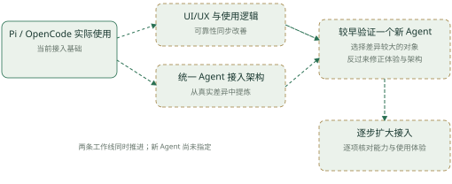
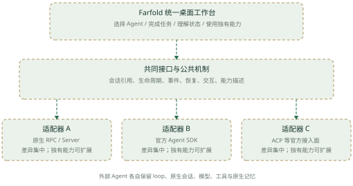
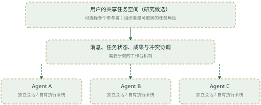
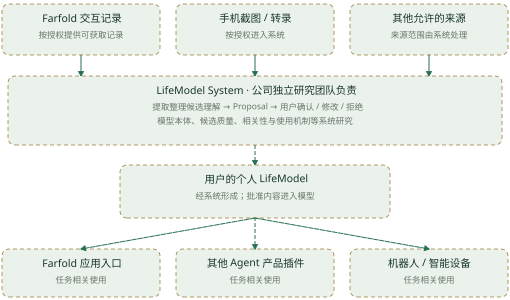
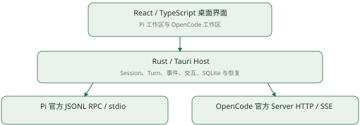

# Farfold 产品与开发方向

> 2026-09-07 · 开发阶段内部对齐与产品说明 · 语音共识修订版

## Farfold 产品与开发方向

2026-09-07 · 开发阶段内部对齐与产品说明 · 语音共识修订版

> 让用户在一个完整的桌面工作台中使用不同 Agent，保留各自特点，把工作清楚、可靠地完成。

Farfold 是公司的独立产品。它希望减少用户在不同 Agent 工具之间反复切换、重新适应操作和判断工作状态的负担。基础价值是提供一致的工作入口和可理解的使用体验：用户选择 Agent 和项目，发出任务，观察真实进展，处理权限与错误，并回到原来的工作。即使没有启用 LifeModel，这些能力和体验也必须成立。

### 各 Agent 是平等可选项

产品架构不固定某个“核心 Agent”。不同 Agent 各自保留执行循环、原生会话、模型配置、工具与特点。Farfold 负责让这些能力能在自己的界面里实际使用；只有展示名称或状态、却无法完成对应操作，不算接入完成。

能力保留的比较基准是：同一个 Agent 直接使用，与通过 Farfold 使用。目标是核心工作能力没有明显损失，但必须逐项验证，不承诺所有 Agent 的全部功能都无损。

| 本文要讲清楚的问题                 | 阅读位置    |
| ---------------------------------- | ----------- |
| 我们现在有什么基础、哪些问题仍在   | 第 1-2 部分 |
| 近期一起推进什么、如何提炼接入架构 | 第 3-4 部分 |
| 以后值得探索什么                   | 第 5 部分   |
| 与 LifeModel System 怎样分工       | 第 6-7 部分 |
| 实现、截图和验证依据是什么         | 附录 A-C    |

本版依据用户本次语音共识重写。正文中的近期纲领是已对齐方向；未来候选和目标架构有单独标记。本文不修改 PRODUCT.md、AGENTS.md 或 active plan。

## 1 当前基础：Pi 与 OpenCode 已经接入

现状 · 当前内部安装版本为 0.1.6

Farfold 已具备 macOS 内部应用基础。Pi 与 OpenCode 通过不同的官方接口接入同一个桌面工作台，能够使用各自原生会话执行真实任务。共同界面已有项目与会话导航、草稿、归档、模型选择、工作状态、停止、Working Copy 和恢复入口。

图 1 · 正式应用中的 Pi 会话。截图采集于 2026-09-07 约 08:40-08:50；本轮沿用，未重新执行图中任务。

| 能据此说明什么                           | 仍需保留的边界                                          |
| ---------------------------------------- | ------------------------------------------------------- |
| 已经有原生工作链路和真实应用界面         | 这不是全部 Agent 接入完成，也不代表所有能力等价         |
| Pi 保留转向、跟进、资源与扩展等特点      | 不同 Agent 的独有能力需要不同交互，不能只剩共同最小功能 |
| 安装记录覆盖两路文件任务、停止与重启续接 | 当前每项任务结果仍由实际文件和 Runtime 反馈核查         |

依据：PRODUCT.md 当前交付说明；plans/runtime-neutral-lifemodel.md 的 C/D 记录；src/App.tsx、OpenCodeWorkspace.tsx。旧截图不作为本轮新的安装验收。

## 2 当前问题：把“能接入”变成“容易用、可靠用”

现状 · UI/UX、使用逻辑与可靠性需要一起改进

图 2 · 正式应用显示 OpenCode 的 Provider 额度错误及重试状态。沿用 2026-09-07 的观察，不能据此推断该服务现在仍不可用。

| 当前需要说清楚的环节                    | 产品要求                                                       |
| --------------------------------------- | -------------------------------------------------------------- |
| 配置、模型可用、请求成功是不同状态      | 已有认证或模型目录不代表账号额度、模型权限及本次请求成功       |
| 项目、Working Copy、会话和 Runtime 切换 | 用户应理解在哪里工作、继续哪条会话；不能把切换误作原生状态迁移 |
| 停止、失败与恢复                        | 保留输入与身份；明确哪些结果未知；不把停止当成撤销文件修改     |
| 共同体验与独有能力                      | 统一入口、状态和导航，同时让各 Agent 的原生能力确实可操作      |

当前的最多两条并发任务受 Working Copy 排他限制；它是分别执行任务的基础，不等于已经实现多 Agent 协作。Changes 主要提供路径级观察，不是完整 diff，也不证明全部变化由当前 Agent 造成。

依据：INTERNAL-USE.md、turn_coordinator.rs、host_store/turn_changes.rs、两路工作区源码。历史人工首次使用与第二成员独立安装记录仍未补齐；本轮没有新增验收。

## 3 已对齐的近期纲领

以实际使用推动体验改善和统一接入架构，两条工作线并行

图 3 · 已对齐的推进关系。虚线框表示后续工作，不是已完成实现；没有指定新 Agent 或日期。

先用好已经接入的 Pi 和 OpenCode：持续处理不清晰的使用逻辑、UI/UX 问题与可靠性问题，同时从两者的共同需求和真实差异中提炼统一 Agent 接入架构。

较早选择一个差异较大的新 Agent，检验共同接口是否够用、适配器是否能承接差异、独有能力能否在界面里使用。无需等现有两路全部完美才进行这一步；新接入的反馈应反过来修正架构和体验。之后再逐步扩大覆盖。

### 如何判断推进有效

| 工作内容         | 应观察到的变化                                      |
| ---------------- | --------------------------------------------------- |
| 改善现有两路体验 | 操作路径更清楚；错误可理解；工作和续接更可靠        |
| 提炼公共机制     | 相同问题共用机制；差异集中在适配层，而非散落各处    |
| 验证新 Agent     | 明确同一 Agent 直用/经 Farfold 的能力差异与使用结果 |
| 逐步扩大覆盖     | 每次接入都有真实可用范围，新增差异继续完善架构      |

方向来自本次语音共识。具体能力清单和验证方式随接入对象落实；未指定新增 Agent，不建立另一份实施计划。

## 4.1 统一 Agent 接入架构：共同机制与差异扩展

目标架构 · 现有代码已有基础，但下图不能当作全部完成

图 4 · 目标结构示意。适配器下方的接口是举例；并非三种互斥类别，也不对应已经指定的新 Agent。

| 层次         | 大白话解释                                                  |
| ------------ | ----------------------------------------------------------- |
| 共同接口     | 让工作台用相对一致的方式表达新建、发送、停止、读状态和续接  |
| 公共机制     | 把可复用的会话引用、事件传递、身份检查与恢复等问题统一处理  |
| 适配器       | 把共同操作翻译成这个 Agent 的真实接口，并保留原生事件和差异 |
| 独有能力扩展 | 共同接口之外有明确扩展位置，界面提供可使用的专属操作        |

统一管理不意味着改造外部 Agent 的执行循环，也不意味着 Farfold 开发替代 Agent 引擎。现有 Host 已具备生命周期、任务准入、事件和持久化机制；但多处代码仍直接区分 Pi/OpenCode，新增 Agent 仍需检验并修正这些抽象。

现状入口：runtime_host.rs、runtime_supervisor.rs、session_controller.rs、turn_coordinator.rs、runtime_registry.rs。目标结构是本次方向说明，不是当前源码的逐项完成清单。

## 4.2 接入技术：允许混合使用官方能力

技术说明与参考 · 协议负责通信，产品仍要负责完整使用体验

| 技术/接口      | 实际含义                               | Farfold 中的判断                                                        |
| -------------- | -------------------------------------- | ----------------------------------------------------------------------- |
| 官方原生接口   | Agent 自己提供的 RPC、Server 等控制面  | 当前 Pi 为 JSONL RPC/stdio；OpenCode 为 Server HTTP/SSE；两条都不是 ACP |
| 官方 Agent SDK | 厂商提供的库，可封装原生执行系统或接口 | 按具体 SDK 的职责选择；不等于只调用模型 API 后自建 loop                 |
| ACP            | 工作台与 Agent 之间的一套共同通信协议  | 可减少部分适配重复；不自动保证能力、恢复和界面完全一致                  |

这三项不是互斥、同层的分类：SDK 可以封装协议，Agent 也可以同时提供原生 Server 和 ACP。应按官方接口、能力保留和维护需求选择；ACP 不是已经确定的唯一底座，也不是必选的第一个开发切片。

### 保留的行业技术参考

| 参考对象                                               | 对本次方向的帮助                                             |
| ------------------------------------------------------ | ------------------------------------------------------------ |
| [Zed / ACP](https://zed.dev/docs/ai/external-agents)   | 工作台通过共同协议连接外部 Agent，可参考会话、事件与能力协商 |
| [Verde](https://github.com/JonathanRiche/verde)        | 不同 Agent 混合采用各自接入面，可参考适配层和生命周期组织    |
| [Codeg](https://docs.codeg.app/reference/architecture) | 共享核心、适配机制和多 Agent 工作台组织，可参考公共层复用    |

可学习成熟的协议客户端、适配模式和事件呈现，减少重复建设；引用具体代码前仍需核对版本、接口稳定性与许可。参考某个产品的实现，并不要求照搬它的 UI、原生历史解析方式或固定主从结构。

上述链接沿用 2026-09-07 既有技术查阅，本轮没有重新做竞品实机验收。协议背景：[ACP 架构](https://agentclientprotocol.com/get-started/architecture)、[ACP 协议概览](https://agentclientprotocol.com/protocol/v1/overview)。参考资料支持探索，不代表 Farfold 已采用或验收相应能力。

## 5 未来候选：交接与共享任务协作

用户提出的研究方向 · 技术上可探索，尚未排期实施

### 候选 A：跨 Agent 任务交接与工作连续性

Agent A 做完一个阶段，Agent B 取得任务要求、证据、成果文件和未完成事项，继续工作。例如 A 完成资料研究，B 在理解已确认要求和来源后写报告，减少用户重新组织背景。

交接的是可获取、可理解的工作材料；不承诺迁移完整原生会话、内部状态或模型推理。同一目录里能看到成果文件，也不等于知道任务历史和决策经过。研究重点是内容选择、来源与版本、遗漏、文件可访问性及授权范围。

### 候选 B：共享任务空间中的多 Agent 协作

图 5 · 研究候选：一个任务环境可以容纳多个独立 Agent。组织者只是本次任务的角色，不是永久核心。

用户在一个聊天/任务环境中让多个 Agent 一起推进工作。可以选择、更换组织者，但其他参与者不必成为它的原生 subagent，也不要求各 Agent 使用不同模型。底层仍有独立会话，需要消息、任务状态、成果、冲突与终止的协调；拼接多个输出并不等于完成协作。

两项可复用部分工作材料和状态机制，但并非已完成或必须依次实施。完整候选记录：farfold-future-directions.md；技术依据见附录 C。LifeModel 未启用，也不因此禁用交接或协作。

## 6 与 LifeModel System 的关系

重要产品关系 · 系统、个人模型、应用入口是三个不同概念

图 6 · 系统范围设想。虚线表示研究/未来集成关系；手机等来源和其他应用出口不代表已交付能力。

| 概念             | 归属与职责                                                                 |
| ---------------- | -------------------------------------------------------------------------- |
| LifeModel System | 公司独立研究团队负责的研究系统，研究如何从授权来源形成和使用个人理解       |
| 个人 LifeModel   | 用户经该系统形成的个人模型；批准内容进入模型，不能将完整概念缩成偏好键值表 |
| Farfold          | 信息来源和应用入口之一；承接系统/方案的集成、信息贡献，以及审批和使用交互  |

系统来源既可包括 Farfold 中可授权取得的多 Agent 交互记录，也可包括授权的手机截图、录音转录等。形成的个人模型未来还可供其他 Agent 产品插件、机器人和智能设备使用；这些是系统范围设想，不是现有可移植接口的交付声明。

本页优先采用本次语音产品对齐。候选质量、模型本体及检索等研究属于独立团队，不推导为 Farfold 当前研发责任。

## 7 LifeModel 与 Farfold 的当前关系

先有最简原型，当前冻结；之后承接独立系统的集成

Farfold 中先做过 LifeModel 最简原型，现阶段将其冻结，集中完善桌面工作台和多 Agent 接入。独立团队研发 LifeModel System 后，Farfold 再承接系统或方案的集成。原型可以提供接口和交互经验，但不是完整系统的定义，也不意味着系统研究已经完成。

图 7 · 原型主入口与停用状态，沿用 2026-09-07 正式应用截图。不是完整 LifeModel System 的界面或本轮新验收。

共同理解的基础链路是：授权来源 → 提取整理候选理解 → Proposal → 用户确认、修改或拒绝 → 批准内容进入个人 LifeModel → 按任务相关性使用。当前原型的来源复核、用户审批和少量条目注入，只覆盖这条链路的一部分实现与治理经验。

> LifeModel 是可选增益。未启用时，Farfold 的基础能力和体验仍应成立；Agent 原有记忆与会话上下文仍由 Agent 管理。交接和协作也不以启用 LifeModel 为前提。

现有实现见 lifemodel.rs、LifeModelPanel.tsx、host_store/lifemodel_gateway.rs。旧 D4 为独立 QA 的治理证据，不能证明完整系统、长期效果或本轮正式安装版的新验收。

## 附录 A1 当前实现与代码地图

供技术交流定位 · 现状图与第 4 部分目标图分开

图 8 · 当前主要链路。Pi/OpenCode 使用不同官方接口，外部 Agent 继续拥有执行循环。

| 问题             | 当前实现与入口                                                                               |
| ---------------- | -------------------------------------------------------------------------------------------- |
| 应用从哪里启动   | React → App 存储检查；Rust lib.rs 初始化 Host、两路 Runtime 与事件机制                       |
| 会话如何持续     | session_controller.rs 核对 Runtime/安装/连接/目录/原生 Session；切换 Agent 打开另一会话      |
| 任务如何控制     | turn_coordinator.rs 管理准入；上限 2，同 Working Copy 排他；并非通用 Agent 编排器            |
| 事件丢失怎么办   | runtime_event_router.rs 有容量和超限标记；session_reconciler.rs 通过官方历史重新核对         |
| 数据放在哪里     | Host SQLite schema 7 保存引用、草稿、目录和原型数据；原生历史由各 Runtime 管理               |
| 配置为什么不同   | Pi 使用原生配置及 SDK 能力桥；OpenCode 使用 Farfold 管理的配置/数据目录                      |
| 原型如何使用理解 | Pi 官方 Extension 的 before_agent_start；OpenCode prompt_async.system；不写入外部 Agent loop |

代码已拆分身份与控制职责，但 UI 和若干 Host 分支仍直接围绕 Pi/OpenCode。统一架构建设应由真实新接入来验证，不能将“有 Adapter 类型”视为已可低成本接入所有 Agent。

精确入口与对应文件链接见附录 C。本文没有运行新 Agent、替换应用或修改产品代码。

## 附录 A2 使用边界：目录、权限与恢复

用现有 UI 解释实际保护范围

图 9 · 会话详情中的 Runtime、原生 Session、Working Copy 和变化范围。沿用 2026-09-07 正式应用截图。

| 能力               | 需要明确的边界                                                                 |
| ------------------ | ------------------------------------------------------------------------------ |
| 权限与项目信任     | OpenCode 原生权限、Pi 资源载入选择、LifeModel 审批各有用途；不是同一个授权开关 |
| 工作目录与 Changes | 目录排他只协调 Farfold 管理的任务；路径变化观察不等于完整 diff 或因果归属      |
| 停止与续接         | 停止不撤销既有副作用；异常中断后工具结果可能未知，恢复不自动重放旧任务         |
| Host 备份          | 包含会话引用、草稿、项目位置与原型数据；不包含认证、原生历史和项目文件         |
| 更新与安装         | 内部 ad-hoc 签名；更新未配置时入口不可用；不能宣称已经具备公开分发能力         |

依据：INTERNAL-USE.md、interaction_registry.rs、host_store/turn_changes.rs、host_store/portable_export.rs、managed_update.rs。完整手动升级需独立保护应用、数据、原生配置与项目。

## 附录 B 验证依据与尚未验证的范围

源码、历史 QA、正式安装身份和真实使用，分别陈述

| 证据层         | 本报告采用的结论                                                             | 限制                                         |
| -------------- | ---------------------------------------------------------------------------- | -------------------------------------------- |
| 源码基线       | HEAD c49148f；生产实现对应 0.1.6 的 4247db2 基线                             | 之后代码差异为测试整理；报告修订没有修改实现 |
| 正式安装身份   | /Applications/Farfold.app；0.1.6；严格签名及二进制摘要在前一轮只读理解中核对 | 身份核对不证明本轮 Provider 或任务成功       |
| 同构建行为记录 | C/D 记录包含两路文件任务、停止、原生续接、权限、并发及恢复                   | 本轮未重跑，部分原始 QA 材料已按此前授权清理 |
| 测试记录       | 137 项前端测试、222 项 Rust 测试及格式/类型/构建检查                         | 采用既有记录，不称本轮新通过                 |
| UI 截图        | 2026-09-07 约 08:40-08:50 的正式应用观察                                     | 沿用截图；不把旧错误当作服务当前状态         |
| LifeModel      | 原型代码与历史 D4 治理验收                                                   | 不等于完整独立系统或长期效果已证明           |

### 已知的工程口径与验证限制

源码 release_certification 仍固定返回 internal_installed_acceptance_pending，与当前交付记录存在口径不一致。能力显示应区分代码支持、安装兼容、运行状态和真实可用性。首次人工真实任务与第二成员独立安装认证，在现有记录中仍未闭环。

既有性能采样来自一台 M4/16 GiB/macOS 15.6：20 次冷进程、热文件缓存；界面可交互 p95 1,013 ms，Pi 恢复至绘制机会 1,832 ms，OpenCode 为 1,533 ms。它不代表 Provider 响应速度、长期任务效率或其他设备结果。

### 精确身份，便于复核

正式可执行文件 SHA-256：26b741ca1e641dbccede6d585d38f1948ad6035a3a7e1a1a797a7cd528fe1100。Pi 固定 0.84.3，OpenCode 固定 1.15.13；各自 SHA-256 见 release-manifest.json。

本版是产品说明与内部对齐稿。历史证据仍保留原日期、范围和出处；不据此宣称完整功能无损、所有设备可用或未来方向已实现。

## 附录 C 资料索引与交流口径

代码供核查，方向以本次共识为准；旧报告保留为历史版本

| 资料                                                                                                                                                                                | 用途                                 |
| ----------------------------------------------------------------------------------------------------------------------------------------------------------------------------------- | ------------------------------------ |
| [PRODUCT.md](/Users/tw/Desktop/farfold/PRODUCT.md)                                                                                                                                  | 现有产品合同与交付说明；本次没有修改 |
| [plans/runtime-neutral-lifemodel.md](/Users/tw/Desktop/farfold/plans/runtime-neutral-lifemodel.md)                                                                                  | 唯一 active plan 与 C/D 历史验收记录 |
| [INTERNAL-USE.md](/Users/tw/Desktop/farfold/INTERNAL-USE.md)                                                                                                                        | 现有认证、日常操作、备份与安装范围   |
| [lib.rs](/Users/tw/Desktop/farfold/src-tauri/src/lib.rs) / [App.tsx](/Users/tw/Desktop/farfold/src/App.tsx)                                                                         | Rust Host 初始化与前端主入口         |
| [session_controller.rs](/Users/tw/Desktop/farfold/src-tauri/src/session_controller.rs) / [turn_coordinator.rs](/Users/tw/Desktop/farfold/src-tauri/src/turn_coordinator.rs)         | 会话与任务控制                       |
| [runtime_event_router.rs](/Users/tw/Desktop/farfold/src-tauri/src/runtime_event_router.rs) / [session_reconciler.rs](/Users/tw/Desktop/farfold/src-tauri/src/session_reconciler.rs) | 事件边界与官方历史核对               |
| [pi_runtime.rs](/Users/tw/Desktop/farfold/src-tauri/src/pi_runtime.rs) / [opencode_protocol.rs](/Users/tw/Desktop/farfold/src-tauri/src/opencode_protocol.rs)                       | 两路官方接入链路                     |
| [lifemodel.rs](/Users/tw/Desktop/farfold/src-tauri/src/lifemodel.rs) / [LifeModelPanel.tsx](/Users/tw/Desktop/farfold/src/components/LifeModelPanel.tsx)                            | 已冻结原型的治理与交互               |
| [未来方向候选记录](/Users/tw/Documents/Codex/2026-09-07/realtime-voice-chat-3/outputs/farfold-future-directions.md)                                                                 | 本次语音确认的交接、协作候选与限制   |

技术补充：[ACP Prompt Turn](https://agentclientprotocol.com/protocol/v1/prompt-turn)说明向指定会话发送内容及接收更新；它不自动完成跨 Agent 交接。[Claude Code Agent Teams](https://code.claude.com/docs/en/agent-teams)提供同类产品内部独立会话、共享任务与消息协调的实验参考，不能据此推断不同厂商 Agent 已无缝互通。其出处来自候选记录，本轮未重新验收。

### 介绍 Farfold 时可以这样说

> Farfold 是让用户在统一桌面工作台使用不同 Agent 的独立产品。我们已接入 Pi 和 OpenCode，当前同时完善体验、可靠性与统一接入架构，并将通过新的差异化 Agent 验证架构。交接与多 Agent 协作是未来研究候选。LifeModel System 由公司独立团队研究，Farfold 是其信息来源和应用入口之一；不启用它，工作台也应好用。
