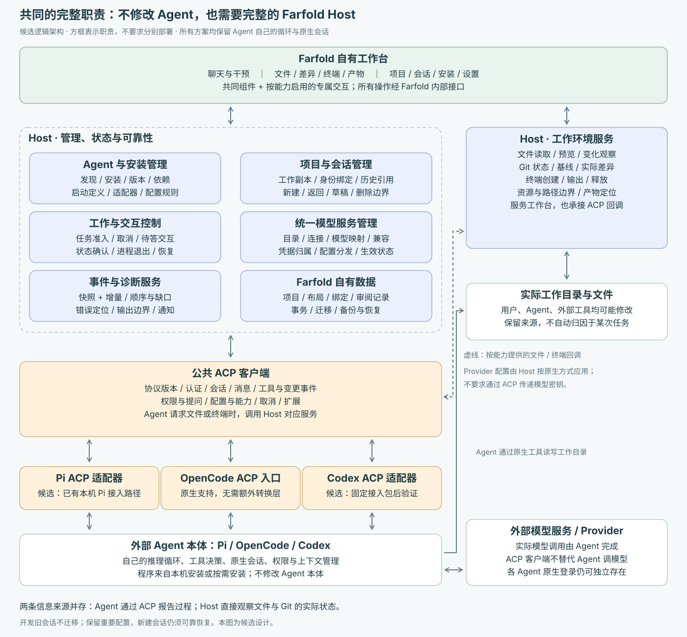
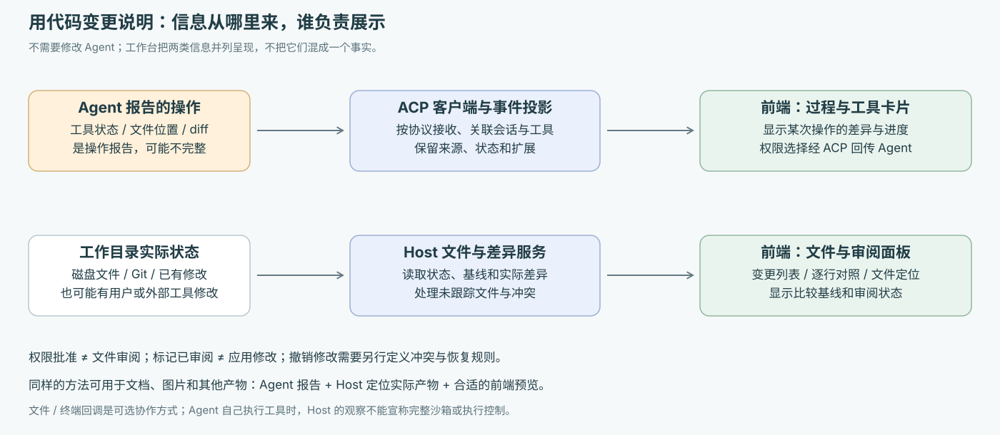
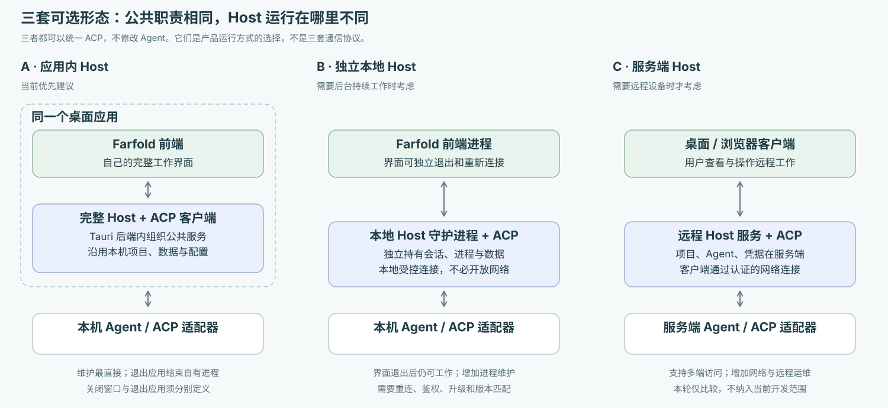
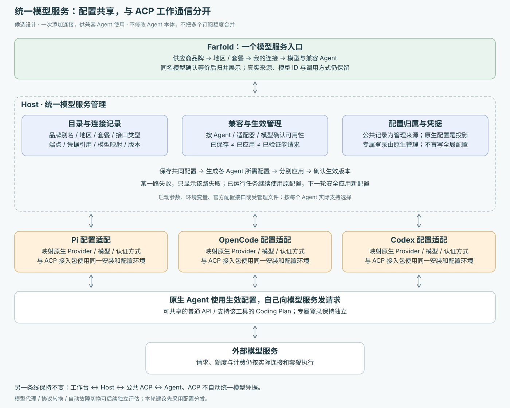
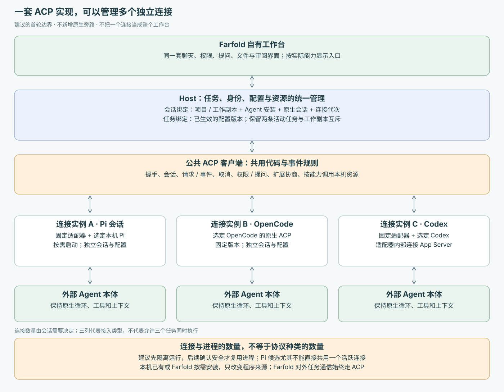
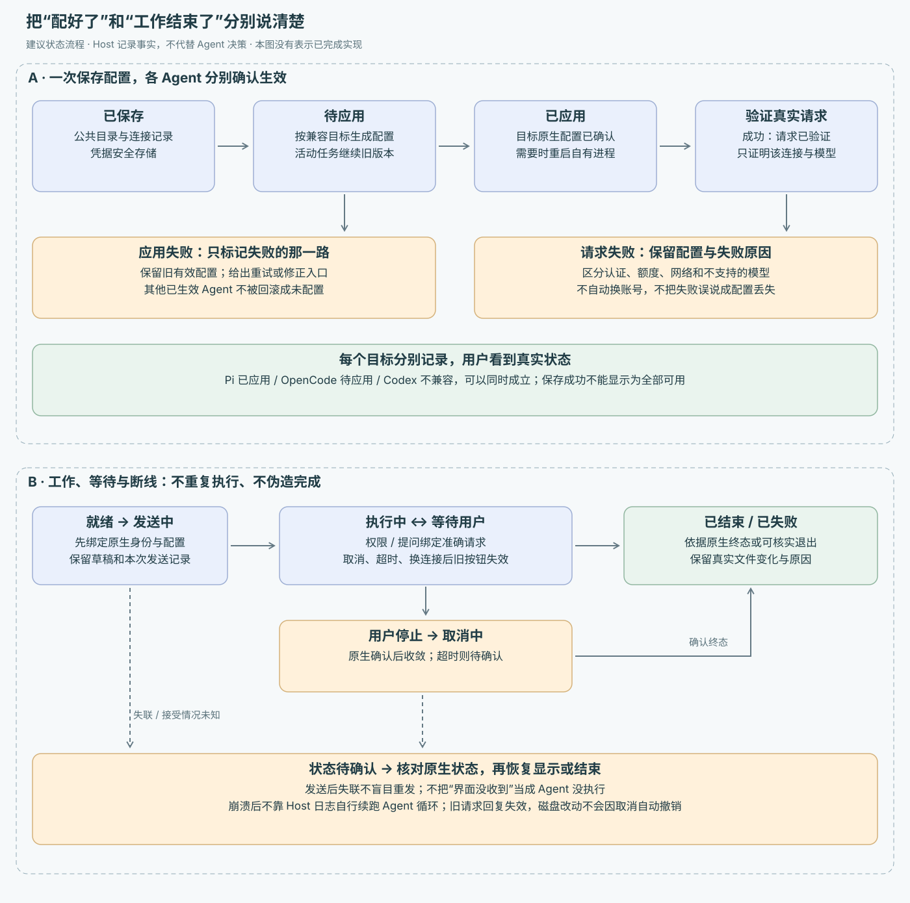

# Farfold Host 架构研究与候选方案

> 2026-09-12 文档校正：本文件保留当时的研究、交接或验收记录。正文中的“当前”、Pi-only / Pi 唯一 Runtime、未采用适配器、未完成或下一步等描述仅对应原记录时点，不是当前执行指令。正式 0.1.7 已支持 Pi、OpenCode、Codex；OpenCode ACP 的 C 阶段已通过 Dev 工程出口，D Pi 仅部分实现、普通 ACP 工作台未接通，E 未开始。开发和自动续接已按用户要求暂停。最新状态以[唯一活动计划](../../plans/runtime-neutral-lifemodel.md)和[正式使用说明](../../INTERNAL-USE.md)为准；不得按旧报告重做已完成工作或清理当前用户数据。

2026-09-10 · 设计研究，不进入开发

建议优先采用应用内模块化 Host + 公共 ACP；最终选择尚未定案。完整 Host 包括管理、状态、资源与数据服务，ACP 只承担其中的标准通信边界。

## 根本问题

不修改 Agent 本体，不代表只写前端。Farfold 要为用户工作提供本机资源与可靠状态，且清楚区分 Agent 上报和实际文件变化。当前是分别实现三种原生接口的客户端，不是自行发明三套协议。

## 同行证据

- [Zed](https://github.com/zed-industries/zed/blob/main/crates/agent_servers/src/acp.rs#L710)：ACP 客户端接到既有编辑器服务。已读 acp.rs 的文件/终端/权限处理注册，以及 acp_thread.rs 的 diff 与事件投影。借用文件、终端、工具卡片与差异呈现的分工；外部 Agent 的历史、checkpoint 等能力仍因集成而异。

- [Codeg](https://docs.codeg.app/reference/architecture)：公共 Rust 核心 + 自有工作台 + ACP。官方架构明确 Host 管数据库、Git、凭据、文件与终端；源码仍有 Agent 专属配置和交互分支。最接近 Farfold 的职责参考；桌面和独立服务复用核心，但这不要求 Farfold 同时做两种部署。

- [Kandev](https://github.com/kdlbs/kandev/blob/main/docs/public/add-agent-cli.md)：公共 ACP 传输 + 独立 Agent 接入定义 + 执行环境。源码 factory 限定结构化协议为 ACP；Agent 定义含发现、启动、环境、权限设置、恢复与认证。可借鉴“共同传输”和“每个 Agent 的启动/配置差异”分离；其任务编排和远程能力不是本轮需求。

- [JetBrains AI Assistant](https://www.jetbrains.com/help/ai-assistant/acp.html)：外部 ACP Agent 接入已有 IDE。官方文档确认本机发现、Registry 安装/更新、自定义启动和原生认证复用路径。借鉴安装与接入体验；不能据此认定任意外部 Agent 都获得 IDE 所有内建 AI 功能。

- [Verde](https://github.com/JonathanRiche/verde)：独立会话守护进程 + 工作台；混合接口。项目 README 描述由会话 daemon 持有任务和终端，GUI 等作为连接它的客户端。可作独立 Host 运行形态参考。此项依据项目说明，未安装验证后台存活与升级行为；协议选择也与候选不同。

## 完整逻辑架构

## 公共机制覆盖范围

### 开始工作

| 用户需要          | 责任与数据来源                                    | 当前源码基础                                             | 还需设计与异常边界                                                                                                    |
| ----------------- | ------------------------------------------------- | -------------------------------------------------------- | --------------------------------------------------------------------------------------------------------------------- |
| 选择 Agent 与安装 | Host 安装目录 + 每个 Agent 的接入定义             | 部分已有：Codex 本机安装校验；Pi/OpenCode 随包           | 补两种来源的共同管理。缺程序、缺依赖、多版本和不兼容须能解释；不静默升级用户环境。                                    |
| 项目与工作环境    | Host 项目 / 工作副本服务；实际文件系统与 Git      | 已有：working_copy_manager、工作副本绑定和隔离 worktree  | 保留。明确非 Git 目录、已有修改、文件路径与环境；同一工作副本的写入准入继续统一。                                     |
| 账号与模型可用性  | Host 配置服务 + Agent 原生认证 / Provider 接口    | 部分已有：三路原生配置与认证路径                         | 补统一入口及兼容 Provider 映射。安装成功、认证成功和模型可用分别展示；不假设账号天然互通。                            |
| 会话与原生身份    | Host 保存安装/连接/工作副本/原生 Session 对应关系 | 已有：records、session_binding_index、session_controller | 保留身份绑定机制并适配 ACP。用户明确开发旧会话不迁移；新架构创建的会话仍须准确绑定与恢复，切换 Agent 不移植原生状态。 |
| 能力与启动设置    | ACP 协商 + Agent 接入定义 + 前端能力入口          | 部分已有：capability_authority 与各 Runtime 原生目录     | 将协议支持、适配器支持、Agent 版本和模型支持联合判断；不能用单一“支持”开关。                                          |

### 工作与干预

| 用户需要             | 责任与数据来源                                    | 当前源码基础                                                      | 还需设计与异常边界                                                                                |
| -------------------- | ------------------------------------------------- | ----------------------------------------------------------------- | ------------------------------------------------------------------------------------------------- |
| 连接与子进程         | Host 生命周期服务 + 公共 ACP 传输                 | 已有生命周期；ACP 通信需要新增                                    | 发现不等于启动；接入本机安装不等于接管已有终端。退出、自有子进程和中断后的恢复须有明确归属。      |
| 消息、附件与输出     | 公共工作台 → Host 准入 → ACP；事件反向返回        | 部分已有：Composer、草稿、原生消息与文件引用                      | 保留并接入共同内容模型。区分路径引用、实际文件内容和图片能力；过大或不支持时保留草稿并提示。      |
| 任务状态与取消       | Host 操作控制 + ACP 命令和响应                    | 已有：turn_coordinator、原生 Stop 与干预路径                      | 保留准入与互斥。发送成功不等于 Agent 接受；取消待确认、退出和完成分别处理，不盲目重放任务。       |
| 权限、提问与登录交互 | Agent 发起；Host 关联待答请求；前端呈现；ACP 回传 | 已有：interaction_registry、原生交互组件                          | 调整为共同生命周期与按能力呈现。会话切换、取消、超时后旧交互失效，不能重复批准。                  |
| 工具与计划展示       | ACP 工具/计划/位置事件 → 公共显示组件             | 部分已有：各路工具与状态呈现                                      | 补一致的公共工具显示模型。原生用词与特殊操作保留；未上报的计划、进度或思考不能自行编造。          |
| 文件与终端回调       | ACP 请求 → Host 资源服务；是否使用由能力协商决定  | 需扩展：已有文件引用/定位，不是完整 ACP 文件/终端服务             | 明确何时读磁盘或编辑缓冲、路径范围、输出上限、进程清理。Native 工具仍可能绕过回调自行执行。       |
| 事件可靠传递         | Host 快照 + 有界事件通道 + 前端投影               | 已有：runtime_event_router、ui_transport、live_session_projection | 保留序号、代次、缺口和来源。改为 ACP 后替换原生解析部分，不能把恢复快照当作所有遗漏消息均已重放。 |

### 查看与审阅产物

| 用户需要         | 责任与数据来源                                 | 当前源码基础                                                  | 还需设计与异常边界                                                                               |
| ---------------- | ---------------------------------------------- | ------------------------------------------------------------- | ------------------------------------------------------------------------------------------------ |
| Agent 报告的改动 | ACP diff / 文件位置 / 工具结果                 | 部分已有：原生事件中有文件变更信息                            | 补通用事件到差异卡片的映射。支持收到的完整 diff，也允许只有文件路径；不能保证所有工具均上报。    |
| 工作区实际变化   | Host Git 状态 / 基线 / 文件观察                | 已有：turn_changes、working_copy_manager                      | 扩展逐行差异与刷新策略。区分已有修改、当前观察、未跟踪文件、重命名和冲突；不能全归因当前 Agent。 |
| 文件与差异界面   | 前端共享文件预览、diff、定位与审阅组件         | 部分已有：TurnChangesSection 路径列表与审阅标记，项目文件定位 | 通用文件预览和逐行 diff 审阅须补产品设计。当前路径审阅不等于完整 diff 编辑器。                   |
| 终端与其他产物   | 前端显示终端输出；Host 定位文件；ACP 提供引用  | 部分已有：原生工具输出、结果文件链接                          | 交互终端、图片/文档预览按本轮产品范围选择，不把所有编辑器能力都设为必做；失败保留原始结果入口。  |
| 接受、拒绝与撤销 | 取决于修改是否落盘、原生接口及 Host 可恢复基线 | 待定：已有“已审阅”，不是应用/撤销修改                         | 先区分授权、审阅、应用和恢复。撤销要考虑用户后续编辑；没有恢复依据就不能承诺一键回滚。           |

### 离开、回来与维护

| 用户需要             | 责任与数据来源                          | 当前源码基础                                                | 还需设计与异常边界                                                                                                 |
| -------------------- | --------------------------------------- | ----------------------------------------------------------- | ------------------------------------------------------------------------------------------------------------------ |
| 历史、草稿与重启恢复 | Host 本地记录 + Agent 原生历史接口      | 已有：草稿、会话打开、reconciler、原生续接                  | 本次切换不迁移开发旧历史；新架构产生的会话须支持重启续接。运行中断、缺失程序或身份改变不能默默新建空会话。         |
| 持久化、迁移和删除   | Host 数据库；原生历史保持原生权威       | 已有：SQLite、导出导入、session_deletion、配对恢复          | 保留。清楚区分删除入口、Host 记录、原生数据、安装文件；公共显示缓存不能成为第二份原生历史权威。                    |
| 错误与可观测性       | Host 诊断，ACP 协议错误，Agent 原生错误 | 已有：performance_trace、事件缺口、恢复界面等基础           | 补统一错误归属：安装/启动/认证/协议/任务/文件。日志脱敏且有界；错误需带用户可执行的恢复入口。                      |
| 通知与多会话体验     | Host 会话注意状态；前端侧栏 / 系统通知  | 已有：session_attention 和共享导航；系统通知范围须单独确认  | 统一等待用户、完成与失败的显示。后台任务与窗口关闭语义取决于所选 Host 形态。                                       |
| 配置、扩展与版本维护 | Host 安装与配置服务 + Agent 原生能力    | 部分已有：Runtime 原生 Skills/Extensions/MCP 与版本固定策略 | 统一的是入口、引用和兼容判断，不把不同 Agent 的 Skills 或权限语义强行互换；更新和主应用发布分开。                  |
| 桌面应用壳与交付     | Farfold 应用生命周期、设置与更新服务    | 已有：lib.rs、managed_update、update_recovery 等            | 保留单实例、窗口和退出规则、设置持久化与配对恢复。Agent 安装更新与主应用更新分开，未配置的更新服务不能显示为可用。 |
| 界面状态与可用性     | 共享工作台与前端状态投影                | 部分已有：共享导航、输入、焦点与性能记录                    | 明确切换会话后草稿和滚动位置、长输出性能、键盘与无障碍、空状态与错误恢复；协议兼容不能代替可用的界面。             |

## 代码变更信息链路

Agent 报告和 Host 实际观察分开。权限批准、文件审阅、应用修改和撤销恢复分别定义。

## 三套候选

A：Host 在 Tauri 应用内，当前优先建议。B：独立本地 Host，适用于退出界面应用后仍需工作。C：服务端 Host，只有明确远程需求才考虑，当前不纳入开发。三者可以共用相同的 ACP 与功能职责，变化在运行归属、通信和升级复杂度。

关闭窗口不等于退出应用；应用内后台运行也可能满足需求。拆出 daemon 不会自动解决电脑休眠、Agent 崩溃或服务升级。

## 当前差距

公共 ACP 与接入管理；完整文件/终端/差异服务；共享工作台产物展示；兼容 Provider 配置复用；ACP 对既有恢复与身份机制的衔接。现有 Host 数据、工作副本、事件可靠性、交互生命周期等应保留完善，而非推倒重做。

## 设计待明确

退出语义；文件审阅深度；开发旧历史不迁移，保留重要配置；新会话恢复；账号复用；协议/SDK/适配器兼容基线；必要与可选工作台能力。完整编辑器、交互终端、浏览器、提交和撤销不因被列入清单就成为本轮必做。

## 研究边界

本轮重点读取官方文档与关键源码，未逐一安装同行应用。部分大文件和仓库下载截断，结论只使用实际读到的部分，未作全仓审计断言。当前 Farfold 的依据是工作区源码，不是新的安装应用验收；既有 Pi 启动超时观察未在本轮解决。只写 reports 下材料，不改应用实现、不替代活动计划。完整来源和源码位置见 HTML 的证据折叠区。

## 统一模型服务设计（修订）

- [CC Switch](https://github.com/farion1231/cc-switch/blob/main/src-tauri/src/provider.rs#L698)：本轮读到的 UniversalProvider 针对 Claude / Codex / Gemini 生成各自配置；另有代理模式。采用统一记录和各 Agent 配置适配；不把代理、自动切换全部带入首轮。

- [OpenCode](https://opencode.ai/docs/providers/)：原生 Provider 认证、模型 ID、自定义端点与配置组合。保留准确原生标识和环境；同名模型不等于同一调用来源。

- [Zed 外部 Agent](https://zed.dev/docs/ai/external-agents)：外部 Agent 通常独立认证；Gemini 在缺少进程密钥时可复用 Zed 的 Google key。共享 ACP 不自动带来共享账号；Farfold 需要独立建设配置管理。

- [Z.AI Coding Plan](https://docs.z.ai/devpack/tool/others)：专用接口与明确支持的工具范围。服务记录须带套餐 / 接口与兼容工具信息；不把订阅等同通用 API。

### 统一目录

品牌用于导航；地区、普通 API、Coding Plan 是服务差异；用户可有多份连接。模型显示名与真实模型标识分开，未知别名保持分开，不通过名称猜测去重。

### 共同配置有归属

建议 Farfold 管理的共享记录为配置来源，各 Agent 的受管理配置为生成结果。发现已有原生配置时先辨认归属；只读发现与导入复用分开。外部修改产生差异时显示冲突，不自动来回覆盖。

### 兼容性有层次

分别判断套餐允许范围、接口格式、模型工具调用 / 图片能力、Agent 与适配器支持。已保存只表示记录成功；已应用表示对应环境接受配置；请求成功才记为本次验证可用。不能因 A 可用就给 B 打勾。

### 配置生效有时间

配置记录带版本，各 Agent 保存已应用版本。正在运行的任务绑定既定连接；切换默认只影响后续新任务，已有会话换模型须走原生支持的操作。一个进程内无法隔离账号时使用明确的连接隔离或禁用并行切换。

### 凭据与删除有边界

优先系统凭据存储及安全引用；必要的原生文件副本须纳入轮换和删除。移除 Farfold 连接不等于撤销供应商账号，也不自动清除用户在其他工具中的独立配置。诊断和导出不含密钥。

### 共享范围诚实

配置复用不自动池化额度，不自动重试或改用更贵的服务。专属登录继续由原生维护；代理是后续可选组件。主应用与外部 Agent 程序安装、配置管理是不同职责。

## 架构压力测试

方向可行；不建议三路同时迁移。以下为设计推演，不是已执行测试。

| 闭合时点           | 场景                                           | 预期行为                                                                                                                    | 所需设计或证据                                                                |
| ------------------ | ---------------------------------------------- | --------------------------------------------------------------------------------------------------------------------------- | ----------------------------------------------------------------------------- |
| 迁移前必须闭合     | 候选包执行来源不符合本机复用要求               | 接入定义必须记录实际执行的 Agent 版本、包来源、配置目录和会话目录；不能把安装了 CLI 误报为正在复用它。                      | 已找到 Registry Pi 的本机启动路径，详见设计规则补查；固定版本与能力仍须验证。 |
| 迁移前必须闭合     | ACP 可以聊天，但原来的权限 / 提问 / 干预不完整 | 列出现有三路已接受能力，标为保留、替代、明确不支持；必要功能缺失时不切换日用版本。                                          | 固定 Agent + 适配器 + ACP / SDK 组合的能力保留表。                            |
| 迁移前必须闭合     | 清理开发旧会话时误删重要配置                   | 用户已明确旧开发会话无需迁移，可在实施时清理。先保留 Provider、模型端点、凭据及必要设置；不波及项目文件和其他工具独立数据。 | 重要配置清单、有效性验证与精确清理范围。本轮只调整设计，没有删除数据。        |
| 配置切片前必须闭合 | Pi 保存成功，OpenCode 应用失败                 | 共享记录保留；逐 Agent 显示生效版本和失败原因，不显示全局全部成功，不回滚另一方正在工作的配置。                             | 应用状态、重试范围和可恢复配置快照。                                          |
| 配置切片前必须闭合 | 两个并行会话选了不同账号，同一进程却共用配置   | 按原生支持绑定会话或连接；不支持隔离时禁止危险切换，不改正在执行任务的凭据。                                                | 配置作用域、进程复用和并发约束的对应表。                                      |
| 配置切片前必须闭合 | 用户在 CLI 改了配置，Farfold 随后又保存        | 识别受管理字段与外部变化；提示冲突，保持无关原生设置。                                                                      | 导入、写入、外部变更与凭据轮换的归属规则。                                    |
| 配置切片前必须闭合 | 国际站和中国站有相同模型名，套餐端点不同       | 展示可聚合，真实连接分开；不丢失地区、套餐、协议、原生 ID。                                                                 | 实际目录样本和等价映射；当前同名 GLM 问题尚未运行复现。                       |
| 配置切片前必须闭合 | 密钥失效或额度耗尽                             | 标明受影响连接；保留草稿，不静默换账号、模型或计费来源。                                                                    | 认证失败、限额与网络故障的区别及操作入口。                                    |
| 安装切片前必须闭合 | 用户自己升级 Agent；断网导致安装只完成一半     | 按选定组合重新检查；下载暂存后校验再启用，保留当前可用安装；不静默更改用户全局安装。                                        | 支持来源、版本检查、可恢复安装与卸载规则。                                    |
| 通信切片前必须闭合 | 命令发出后断线，不知道有没有执行               | 状态标为未知并查询原生状态；不自动重发可能修改文件的任务。                                                                  | 取消确认、退出、快照缺口和会话关联流程。                                      |
| 审阅切片前必须闭合 | Agent 和用户同时编辑同一文件                   | 分别展示 Agent 报告与工作区实际差异；只读审阅先明确，撤销须比较基线和后续修改。                                             | 已跟踪 / 未跟踪 / 二进制 / 大文件 / 重命名 / 冲突处理。                       |
| 交付前必须验证     | 窗口关闭、完整退出、电脑休眠、升级各不相同     | A 方案明确退出规则；未知任务恢复诚实。独立后台不是休眠或崩溃的保证。                                                        | 运行寿命设计及未来安装应用冷启动 / 配对恢复检查。                             |

一个 Pi ACP 候选以内嵌 SDK 执行，不能推断它会复用本机 CLI：https://github.com/victor-software-house/pi-acp 。此包尚未选定；补查已找到另一 Registry 候选可启动本机 Pi，见设计规则。

建议顺序：设计闭合 → 获批后一个完整工作切片 → 逐路替换并删除替代路径 → 三路配置与冷恢复验证。当前不启动开发。

仍待对齐：运行寿命、配置归属、只读审阅范围和重要配置保留范围；开发旧会话不迁移。

# Farfold 接入研究索引与设计规则补全

2026-09-10 · 设计研究；不进入开发

统一 ACP 链路保持不变。开发旧会话不迁移，只保留重要配置；新会话保存恢复必须正常。

## 找到的已有材料

- [早期 Agent 普查](../../research/2026-08-30/runtime-census-and-contract.md)：17 个深度候选及当时 Registry 快照；包含固定版本与 D0–D3 证据分层。历史产品状态已过时，不作为今日支持清单。

- [历史隔离验证](../../research/2026-08-31/d2-minimal-lifemodel-native-acceptance.md)：可追溯早期 OpenCode、Codex、Kimi 的隔离验证。仅借用原生基础接口证据，不恢复 LifeModel 研究或额外 Runtime 开发。

- [12 家工作台对照](../2026-09-09-alignment/Farfold-同类Agent工作台技术路线对照.md)：比较 Host 的 ACP、混合接口、终端三种路线；回答同行怎么做，不是各 Agent 的现行兼容证明。

- [公共职责清单](../2026-09-09-alignment/Farfold-公共架构职责覆盖清单.md)：ACP / Host / 前端边界；本报告扩充其正常和失败流程。

## 旧候选范围

Kimi、Kiro、Cline、Cursor、Mistral Vibe、goose、Gemini、Qwen 在旧报告中有 ACP 或 Registry 入口线索；Hermes、Factory Droid、Copilot SDK、Claude Agent SDK、Amp、OpenHands 则涉及不同官方接口或包装方式。旧报告另含 Pi、OpenCode、Codex。此处只恢复旧目录，不把所有名字标成今日 ACP 兼容，也不把它们加入下一轮开发范围。

## 当前三路的 ACP 补查

### OpenCode

[官方原生 ACP；可以选定程序路径以 ACP 模式启动](https://opencode.ai/docs/acp/)。文档支持工具、权限和原生配置；明确部分内置 undo/redo 命令不支持。本机程序复用有明确文档路径；固定 1.15.13 的 ACP service 源码存在取消不支持路径，必须解决；旧 HTTP/SSE 验收不替代 ACP 验收。

### Codex

[新维护位置 agentclientprotocol/codex-acp；适配器启动 App Server，允许指定 Codex 程序](https://github.com/agentclientprotocol/codex-acp)。默认 npm 包依赖一份 Codex；可以用 CODEX_PATH 指定现有程序。main 清单为适配器 1.11.0 / Codex ^0.153.4。当前 Farfold 固定 0.143.0；未证明兼容新适配器。选发布版与对应 Codex 组合，不能直接接 latest 后称为已验证。

### Pi

[Registry 为 svkozak/pi-acp，固定条目 pi-acp@0.0.33；启动本机 Pi RPC，可指定程序路径](https://github.com/agentclientprotocol/registry/blob/main/pi-acp/agent.json)。此包不嵌入 Pi SDK；README 要求已装 Pi 0.80.4+。extension select/confirm 有映射，input/editor 不支持并取消；模型选择调用 Pi RPC。已找到符合本机复用方向的候选；与固定 Pi 0.84.3 的完整行为仍未实测。无 ACP 文件/终端委托，传入 MCP 不接入 Pi；不得承诺原生交互完整保留；发布包还缺少原生 steer / follow_up 消息路径。

Pi 详细源码：[启动](https://github.com/svkozak/pi-acp/blob/main/src/pi-rpc/process.ts#L118)、[交互与取消](https://github.com/svkozak/pi-acp/blob/main/src/acp/session.ts)、[限制](https://github.com/svkozak/pi-acp/blob/main/README.md)。Registry 包安装不包含安装 Pi 本体，已核验发布包 integrity 及六个关键文件；运行行为尚未实测。详见本报告三路能力与状态补充。

## 正常与失败规则

| 流程                | 正常路径                                                                                                                 | 失败 / 冲突                                                                                            | 状态                                                |
| ------------------- | ------------------------------------------------------------------------------------------------------------------------ | ------------------------------------------------------------------------------------------------------ | --------------------------------------------------- |
| 01 · 安装来源       | Host 先列出已知位置和用户选定路径的安装；显示版本和来源；缺失时提供按需安装。复用程序和复用账号分别记录。                | 找不到则允许指定路径；多版本保留明确选择；不扫描读取任意账号数据。只启动选定的入口。                   | 已对齐：本机优先 + 按需安装，主包不带 Agent。       |
| 02 · 固定接入组合   | 每个安装引用明确的 Agent、适配器与依赖版本；握手确认协议和能力。                                                         | 未知版本显示未验证；明确缺少必要接口则阻止开始并说明升级 / 更换选定版本路径；不偷偷走原生旁路。        | 待事实核查：三路的确切支持组合。                    |
| 03 · 启动与清理     | Host 持有自己启动的进程，设置项目、配置目录和生命周期；ACP 成功握手后进入可工作状态。                                    | 启动超时先确认并清理本次拥有的失败进程；保留诊断。不能按程序名杀其他工具启动的进程。                   | 建议规则；未进入实现。                              |
| 04 · 添加共享连接   | 一次保存端点、协议、地区 / 套餐、凭据引用与模型映射；逐 Agent 生成受管理配置。                                           | 保存、应用、需要重启、请求验证分别显示；任一路失败不显示全部成功，失败路不影响其他已生效路。           | 已对齐体验；具体配置接口按接入包确定。              |
| 05 · 配置归属       | Farfold 管理自己的共享连接与投影；既有原生账号可作为独立连接保留。导入已有连接须说明范围，之后一个字段只有一个写入来源。 | 检测到用户外部修改受管理字段时暂停覆盖，显示两份差异供选择；未管理字段保留，不双向无限同步。           | 建议默认；是否同步外部全局配置未获决定，默认不做。  |
| 06 · 选择与生效     | 全局默认只影响新任务；会话选定的连接与模型保留。任务开始绑定生效配置版本。                                               | 任务中改设置进入待应用，不能悄悄更换当前模型或账号。原生进程配置无法隔离时，分连接运行或禁用并行切换。 | 作用域需按 Agent 核实；用户无需重复输入密钥。       |
| 07 · 模型目录       | 品牌层归组，服务地区 / 套餐和账号连接分开；真实模型 ID、接口和能力作为底层记录。                                         | 同名不自动删；只归并有等价依据的条目。无映射时显示来源；禁止把国际站 key 自动投到另一端点。            | 建议规则；用户报告的 GLM 重复尚未运行复现。         |
| 08 · 凭据维护       | 轮换共享连接凭据后逐目标应用；保留每一路的生效版本；原生登录按原生生命周期维护。                                         | 失效、限额、网络故障分开显示。日志、导出和错误不带密钥；移除连接不等于注销供应商账号。                 | 实施时列精确配置保留与删除清单。                    |
| 09 · 创建与发送     | 选项目 / 工作副本、Agent 安装和连接，创建原生会话并保存身份后发送。共用准入限制和同工作副本互斥。                        | 创建失败保留草稿；发送后断线且接受情况未知时不自动重发。先检查原生状态，避免同任务重复修改文件。       | 沿用当前最多两条活动任务的约束；未提出扩大并发。    |
| 10 · 运行状态       | 统一显示：启动中、就绪、执行中、等待用户、取消中、已结束、失败或状态待确认；保留原生原因。                               | 未知不是失败也不是已完成；新一代连接不能接受旧一代响应改变当前任务状态。                               | 用户用语为设计稿，不新增第二个 Agent 决策循环。     |
| 11 · 权限与提问     | Agent 发起，Host 绑定到会话 / 任务 / 请求，前端显示原生选项，经 ACP 回答。                                               | 取消、退出或请求失效后旧按钮失效；不自动批准、不用普通聊天冒充原生提问。原生不提供的能力如实缺省。     | 必要能力由现有已接受行为表决定。                    |
| 12 · 取消与中断     | 用户停止后显示取消中，直到原生终态或可核实退出；记录已发生的文件变化。                                                   | 超时显示状态待确认，可提供结束自有进程的明确操作；取消不等于撤销磁盘修改。                             | 建议规则；不同 Agent 的完成信号需对应。             |
| 13 · 事件与恢复     | 公共通道保留顺序、来源与连接代次；有界输出，断线后用真实快照和原生记录恢复显示。                                         | 发现缺口就标明并补读支持内容；不编造遗漏工具输出，不把持久化失败报成保存成功。                         | 保留现有事件可靠性基础；替换原生解析。              |
| 14 · 产物审阅       | 工具卡片展示 Agent 上报，文件面板展示真实工作区差异并注明比较基线；只读预览与已审阅分开。                                | 非 Git、未跟踪、大文件、二进制、冲突与外部编辑分别处理；未知归因不标成全部由 Agent 修改。              | 建议首轮只读预览 / diff；编辑、提交、撤销另行决定。 |
| 15 · 本机回调       | 按协商能力承接 ACP 文件与终端请求；校验路径和拥有关系，结束时释放自己创建的资源。                                        | 不支持则不宣告支持；输出截断保留提示；不能把 Host 观察或回调冒充对原生工具的完整沙箱。                 | 依据所选适配器实际请求决定必做回调。                |
| 16 · 新会话续接     | 新架构产生的会话保存安装、项目、连接与原生会话引用；重启后重新发现并续接。                                               | 认证过期先恢复连接；版本或目录变化先解释原因。打不开不悄悄新建空白会话。                               | 必须保留日常恢复能力；不要求迁移旧开发记录。        |
| 17 · 窗口与退出     | 建议应用内 Host；关闭窗口保留应用时可继续，完整退出先处理正在执行任务。                                                  | 强退 / 崩溃 / 休眠后按未知状态恢复；不承诺完整退出后后台继续，不因此引入另一套控制中心。               | 关闭窗口是否默认后台继续仍为产品选择。              |
| 18 · 更新与安装失败 | 安装内容先暂存校验，再启用选定版本；Agent / 适配器更新与主应用更新分别管理。                                             | 失败保留当前可用安装，升级不影响活动进程；用户自行升级后重新校验。应用更新保护重要配置与新产生的数据。 | 不自动升级用户全局程序；更新建议不是本轮执行。      |
| 19 · 开发旧数据     | 本次切换不迁移开发旧会话；先列重要 Provider、端点、模型和必要设置，保留后验证可读取与可用性。                            | 删除范围限制在明确的 Farfold 开发记录；不连带删除项目文件、独立原生历史或其他工具配置。                | 已对齐方向；本轮没有执行清理。                      |

## 未来验证要求

一次录入后逐路确认实际连接与模型；断线不重发任务；权限请求不串会话；取消结果可确认；差异有基线与来源；安装应用冷启动恢复新会话；升级和清理保住配置。本轮没有运行这些验收。

# Farfold 三路 ACP 能力保留与状态流程

2026-09-10 · 设计补充 / 修订 5

本轮继续补设计，不进入开发。最重要的变化是：从“有 ACP 入口”进一步核对“能否保留已有操作”。三路都不能仅靠握手结果标成可替换；下表把明确缺口、源码路径和未验证项分开。

对照基础为当前工作区 src/runtime/pi.ts、opencode.ts、codex-turn.ts、codex-interaction.ts、components/ExtensionDialog.tsx 与 INTERNAL-USE.md。类型或源码存在不等于本轮重新验证安装应用；沿用已有验收边界，未扩大图片、Codex API Key 等产品声明。

## 能力对照

| 操作                      | 当前基础 / 目标                                          | Pi                                                                                        | OpenCode                                                                                 | Codex ACP                                                          | 设计结论                                                              |
| ------------------------- | -------------------------------------------------------- | ----------------------------------------------------------------------------------------- | ---------------------------------------------------------------------------------------- | ------------------------------------------------------------------ | --------------------------------------------------------------------- |
| 01 · 安装与启动           | 本机优先，缺失时按需安装；固定安装引用                   | 发布包 0.0.33 启动本机 Pi RPC，可指定 Pi 路径；不含 Pi 本体                               | 官方程序原生 acp 入口，可指定二进制路径                                                  | 适配器经 App Server；可指定 CODEX_PATH，默认包另有 Codex 依赖      | 管理程序来源与连接实例；不要把 npm 默认依赖误说成本机复用             |
| 02 · 正常任务与流式结果   | 三个 Runtime 已有各自发送 / 事件入口                     | ACP prompt → Pi prompt，结果经会话事件转换                                                | 固定标签 service 将 prompt 转 SDK session.prompt；event 转流式消息                       | main 具有 ACP 任务、事件到 App Server 的映射                       | 均有源码路径；仍需固定组合实机验证，握手成功不等于任务成功            |
| 03 · 运行中插话           | Pi steer / follow_up；Codex 原生 steering                | 明确差异：忙时进入适配器队列，当前 settled 后才执行；没有原生 steer / follow_up 消息路径  | 本轮没有确认等价即时插话；不把再次 prompt 当作保证                                       | main 示例提供 _session/steering 扩展；不是仅实现基础 prompt 即获得 | 把立即干预、结束后追加、普通发送分开建模；Pi 候选不能直接等价替换     |
| 04 · 停止                 | 现有三路均有原生停止入口；停止不是撤销                   | cancel 清队列、发 abort，等 agent_settled 后结束当前 prompt                               | 固定标签 agent.cancel 委托 service.cancel；读到的 service 返回 UnsupportedOperationError | main cancel 调用 interruptSessionTurn，等待原生 turn 完成事件      | OpenCode 停止是必须解决的接入条件；进程强退不可冒充正常取消           |
| 05 · 权限与选择           | 保留原生选项及其一次 / 会话 / 策略作用范围               | extension select / confirm 经 requestPermission 表达；并非全是工具授权                    | 固定标签映射 once / always / reject；按原生请求回复                                      | 权限扩展保留原生 optionId 与作用范围，不能按显示名称推断           | Host 关联会话、任务、请求、连接代次；前端区分选择问题与执行授权       |
| 06 · 文本提问与扩展界面   | Pi input / editor / 状态组件；Codex 已接受 Plan 原生提问 | 发布包 input / editor 提示不支持并取消；多种扩展 UI 没有等价映射                          | 本轮未确认自由文本提问的完整映射，不列为已有                                             | main handleUserInput 依赖客户端表单能力；不支持时返回空 answers    | Pi 是明确保留缺口；Codex 要实现并协商表单，保护 Other、密文、取消含义 |
| 07 · 模型与思考等级       | 原生模型目录、选择及实际能力                             | get_available_models / set_model；思考等级使用固定列表，不能等同真实支持                  | 固定标签目录与配置选项映射模型、variant 和 mode                                          | README / main 提供模型与配置选项；依赖选定版本                     | 统一展示，但支持范围以运行时信息和接入组合为准；不制造假选项          |
| 08 · Provider 一次配置    | 新目标：兼容 Agent 复用同一连接，不重复录入              | 模型选择不负责创建或分发共享凭据                                                          | 读取原生配置不等于同步 Farfold 的统一目录                                                | 认证 / 模型选择不等于任意订阅跨 Agent 通用                         | 独立配置服务逐 Agent 投影；保留真实端点与套餐，分别记录生效结果       |
| 09 · 新会话恢复           | 新架构仍须保存原生身份并冷启动恢复；旧开发会话不迁移     | load 使用原生会话文件，回放 get_messages；历史工具展示经过合成                            | 固定标签有 load / resume 和消息回放路径                                                  | main 存在 load / 历史合并路径；旧 Codex 组合未验证                 | Host 保存原生引用与缺失范围；打不开不新建空会话冒充恢复               |
| 10 · 多会话与隔离         | 最多两条活动任务，同工作副本互斥                         | load 执行 closeAllExcept；不能假定同一连接同时保留多个活跃 Pi                             | 源码有按会话记录；跨项目、配置、取消隔离未实测                                           | 源码有会话集合；跨连接 / 原生版本组合隔离未实测                    | 公共客户端是一套代码；可有多个连接，建议先按会话 / 配置需要隔离进程   |
| 11 · 代码与产物           | 当前已有路径变化 / 审阅基础；完整 diff 为待补设计        | edit / write 前后快照可产生实时 diff；历史回放不重建这些快照                              | 工具 / 事件及编辑权限有映射；完整历史 diff 保真未验证                                    | README 提供工具 / diff 路径；历史完整性需固定组合验证              | Agent 报告 + 真实工作区差异两条来源；shell 改文件不能只靠工具卡片     |
| 12 · 命令、内容与本机回调 | 保留已接受的日常操作；可选能力如实展示                   | 部分 slash / compact 与图片有映射；扩展命令被过滤；无音频、无文件/终端委托，MCP 未传入 Pi | 固定标签有命令 / compact / image / MCP 路径；官方说明部分 undo / redo 不支持             | README 提供图片 / 命令等路径；所有扩展不可默认当标准必有           | 按支持组合声明能力；只实现且验证过的本机回调才对外宣告                |

## 一套实现与多个连接

## 配置与工作状态

## 边界与未决项

### 已收紧的公共边界

一套客户端实现、多连接实例；Host 统一准入和身份归属，各连接保留原生能力及扩展。没有恢复三套 Farfold 原生客户端。

### Pi 的候选选择尚未闭合

Registry 发布包符合复用本机程序，却缺少当前原生插话与部分扩展交互。优先查现成维护版本或推动适配器补齐；若选择维护适配器扩展，单独评估成本。不能悄悄删功能或改走原生旁路。

### OpenCode 的取消必须闭合

本轮固定标签源码存在取消不支持路径。先选定并核实具有原生 ACP 取消的官方版本，再验证任务确实停止；若没有满足版本，报告接入阻塞。Farfold 不补一条 HTTP abort 旁路，也不修改 Agent 本体。

### Codex 要冻结完整组合

已有权限、表单、插话扩展线索，但它们与当前旧二进制未证明兼容。需要固定 ACP SDK、适配器与 Codex 三者；只声明实际支持的表单和扩展。

### 配置归属有明确建议

Farfold 只写自己管理的连接配置；每个目标独立记录应用结果。已有原生登录可以保留独立来源，不做隐式双向同步。活动任务绑定旧配置，新配置在安全边界生效。

### 首轮范围保持克制

应用内 Host；只读文件 / diff 审阅；保留两条活动任务与工作副本互斥。完整退出不承诺继续工作。旧开发会话不迁移，保留重要配置；新会话恢复是必需项。

## 失败场景

- 发送后马上断线：先显示状态待确认，查询原生状态；没有证据时不自动补发。

- 等待授权时取消或切换会话：旧请求立即失效，回复不能落到另一会话；原生是否结束单独确认。

- 一个 Agent 改 Provider，另一个仍在运行：运行任务保持绑定配置；修改只在对应目标安全边界应用，显示每路结果。

- 外部编辑器与 Agent 同时改文件：diff 标明比较基线；不把所有磁盘改动归给 Agent，不自动覆盖外部改动。

- 升级失败或用户移动本机程序：旧可用安装保留；会话仍绑定原生身份；先修复启动引用，不伪造新会话恢复。

- 新会话冷启动恢复时缺少工具细节：恢复可读取内容，明确缺失范围；不把合成工具记录当作完整执行历史。

## 评估

架构方向可行，但当前候选不能直接作为三路无损替换。先闭合 Pi 原生干预 / 扩展交互、OpenCode 取消和 Codex 固定版本 / 扩展组合。共享配置与恢复已有明确建议流程，仍需后续实现验证。本轮未运行模型请求、性能压测、安装、升级或数据清理。

## 来源

- [Pi 发布包元数据](https://registry.npmjs.org/pi-acp/0.0.33)：只读下载并校验 npm integrity；六个关键 sourcemap 文件与本轮 main 一致，相关路径同时核对发布 JavaScript。未启动运行。

- [Pi 排队、交互与 diff](https://github.com/svkozak/pi-acp/blob/main/src/acp/session.ts)：运行中排队、取消等待、扩展 UI 与文件快照映射。

- [Pi 恢复与连接管理](https://github.com/svkozak/pi-acp/blob/main/src/acp/agent.ts)：load 的 closeAllExcept、原生历史回放和配置选项。

- [OpenCode 固定标签 service](https://raw.githubusercontent.com/anomalyco/opencode/v1.15.13/packages/opencode/src/acp/service.ts)：本轮读到 prompt、配置、恢复、MCP 与取消拒绝实现；由同标签 agent.ts 委托。公开源码事实，不是安装二进制实测。

- [OpenCode 权限映射](https://raw.githubusercontent.com/anomalyco/opencode/v1.15.13/packages/opencode/src/acp/permission.ts)：原生 once / always / reject；事件来源另见同目录 event.ts。

- [OpenCode ACP 官方说明](https://opencode.ai/docs/acp/)：原生启动方式与部分内置命令限制。

- [Codex ACP 依赖与入口](https://github.com/agentclientprotocol/codex-acp)：README、package.json；读取 main，不作为冻结发布组合。当前 Farfold Codex 0.143.0，main 依赖 ^0.153.4，兼容未证明。

- [Codex 原生提问映射](https://github.com/agentclientprotocol/codex-acp/blob/main/src/CodexElicitationHandler.ts)：handleUserInput 需表单能力；选择、Other 和 isSecret 元数据；未支持时返回空答案。

- [Codex 权限边界](https://github.com/agentclientprotocol/codex-acp/blob/main/docs/permission-extension.md)：保留原生 optionId 和作用范围；协议基础能力与扩展分开。

- [Codex 插话示例](https://github.com/agentclientprotocol/codex-acp/blob/main/examples/steering.ts)：_session/steering 扩展示例；仍须核验冻结 SDK / 适配器 / Agent 组合。

- [Codex 取消与历史](https://github.com/agentclientprotocol/codex-acp/blob/main/src/CodexAcpServer.ts)：cancel 委托 interruptSessionTurn；有历史合并路径。
