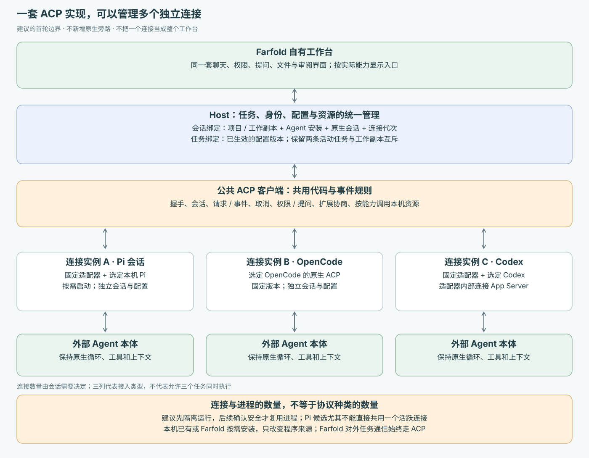
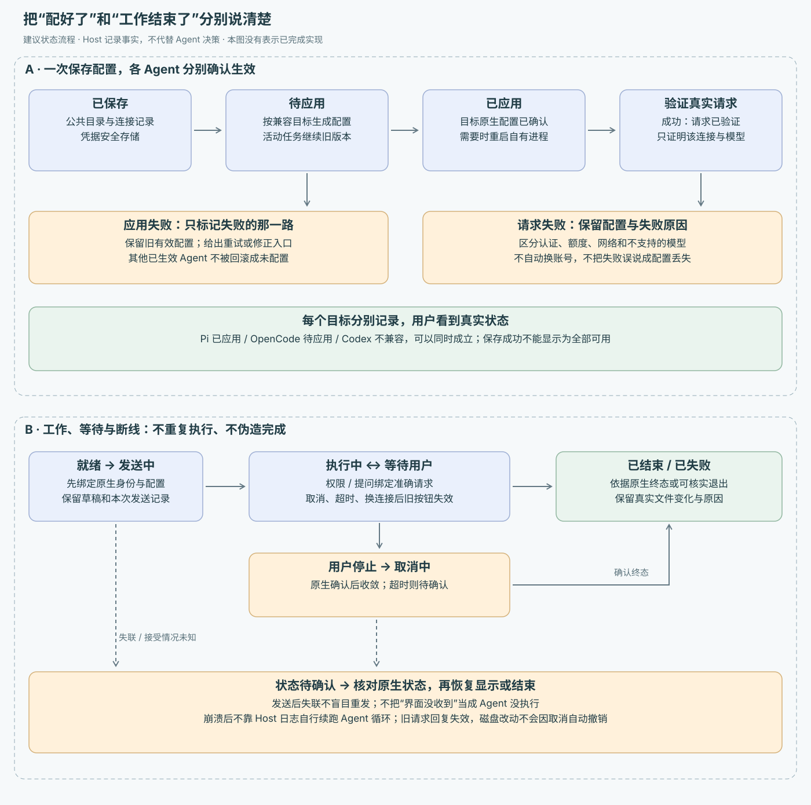

# Farfold 三路 ACP 能力保留与状态流程

2026-09-10 · 设计补充 / 修订 5

原 2026-09-10 设计基线如下，不是当前暂停开发的指令。2026-09-12 C 已完成 OpenCode Dev 工程出口，用户随后授权 D、E；
当前 Pi 更新见下节，其余未更新行仍是历史候选证据，不把旧 OpenCode 取消缺口当作当前 C 结论。
三路都不能仅靠握手结果标成可替换；下表把明确缺口、源码路径和未验证项分开。

最新校正（2026-09-12）：用户随后批准固定 pi-acp 有限维护；新维护版本已经补上原生表单、通知、
干预映射、终态及身份保护，公共撤销/启动已有定向验证。下节仍描述**未修改上游发布包**的缺口，
不等同于维护版本的当前状态，也不能将定向测试当作 Pi 桌面验收。普通 Pi ACP 工作台未接通，E 未开始。
开发和自动续接现已按用户要求暂停。当前进度见[活动计划](../../plans/runtime-neutral-lifemodel.md)，
维护版本与测试证据见[实施记录](Farfold-实施与验证记录.md#2026-09-12-d-接线基础终态结清身份响应与公共启动)。

## 2026-09-12 Pi 固定候选增量

- 最新 npm 仍为 `pi-acp@0.0.33`，原发布包 integrity 未变；固定 Pi `0.84.3`、SDK `0.26.0`、Zod `3.25.76`、Node `22.22.3`。
  源程序与 Dev 所带 Pi 摘要均为 `e844dc14981fc70c7f4c45c5ba5f8c237199891bd8520d1ed21fe78be6479dac`。
- 已实际启动固定发布包与 Pi，对相同隔离扩展作无模型对照：select=Two、confirm=false 保留；native input/editor 有正文，
  ACP 返回 null 并提示不支持；native 九类 UI 均产生事件，而 ACP 未透传 setStatus/setWidget/setTitle/set_editor_text。
  通知可见，选择/确认被装成 permission，不代表 Pi 所有选择均是工具授权。
- steer/follow_up 缺口仍为固定发布源码证据，未作真实模型运行中的干预验收；不能用 adapter 的普通 prompt 队列替代。
- 本地 fixture 模型目录可见，只证明读配置；零模型请求，不证明真实 Provider、保存/应用/验证、取消恢复或 installed 产品可用。
  Pi 原生 RPC 已声明不支持的任意 TUI custom/footer 等不被扩大为本轮新增保留义务。
- 原候选不能直接无损替换的结论经协调复审确认。有限维护固定上游适配器或等待上游的具体取舍、模块范围、退出条件见
  [D 首片实施记录](Farfold-实施与验证记录.md#2026-09-12-d-首片pi-候选核验与路线决策)。用户随后已批准有限维护路线；隔离适配器实施进展见该记录后续节，旧 Pi 路径未删除，尚未接普通 Host/UI。

对照基础为当前工作区 src/runtime/pi.ts、opencode.ts、codex-turn.ts、codex-interaction.ts、components/ExtensionDialog.tsx 与 INTERNAL-USE.md。类型或源码存在不等于本轮重新验证安装应用；沿用已有验收边界，未扩大图片、Codex API Key 等产品声明。

## 能力对照

| 操作                      | 当前基础 / 目标                                          | Pi                                                                                        | OpenCode                                                                                 | Codex ACP                                                          | 设计结论                                                              |
| ------------------------- | -------------------------------------------------------- | ----------------------------------------------------------------------------------------- | ---------------------------------------------------------------------------------------- | ------------------------------------------------------------------ | --------------------------------------------------------------------- |
| 01 · 安装与启动           | 本机优先，缺失时按需安装；固定安装引用                   | 发布包 0.0.33 启动本机 Pi RPC，可指定 Pi 路径；不含 Pi 本体                               | 官方程序原生 acp 入口，可指定二进制路径                                                  | 适配器经 App Server；可指定 CODEX_PATH，默认包另有 Codex 依赖      | 管理程序来源与连接实例；不要把 npm 默认依赖误说成本机复用             |
| 02 · 正常任务与流式结果   | 三个 Runtime 已有各自发送 / 事件入口                     | ACP prompt → Pi prompt，结果经会话事件转换                                                | 固定标签 service 将 prompt 转 SDK session.prompt；event 转流式消息                       | main 具有 ACP 任务、事件到 App Server 的映射                       | 均有源码路径；仍需固定组合实机验证，握手成功不等于任务成功            |
| 03 · 运行中插话           | Pi steer / follow_up；Codex 原生 steering                | 明确差异：忙时进入适配器队列，当前 settled 后才执行；没有原生 steer / follow_up 消息路径  | 本轮没有确认等价即时插话；不把再次 prompt 当作保证                                       | main 示例提供 _session/steering 扩展；不是仅实现基础 prompt 即获得 | 把立即干预、结束后追加、普通发送分开建模；Pi 候选不能直接等价替换     |
| 04 · 停止                 | 现有三路均有原生停止入口；停止不是撤销                   | cancel 清队列、发 abort，等 agent_settled 后结束当前 prompt                               | 固定标签 agent.cancel 委托 service.cancel；读到的 service 返回 UnsupportedOperationError | main cancel 调用 interruptSessionTurn，等待原生 turn 完成事件      | OpenCode 停止是必须解决的接入条件；进程强退不可冒充正常取消           |
| 05 · 权限与选择           | 保留原生选项及其一次 / 会话 / 策略作用范围               | extension select / confirm 经 requestPermission 表达；并非全是工具授权                    | 固定标签映射 once / always / reject；按原生请求回复                                      | 权限扩展保留原生 optionId 与作用范围，不能按显示名称推断           | Host 关联会话、任务、请求、连接代次；前端区分选择问题与执行授权       |
| 06 · 文本提问与扩展界面   | Pi input / editor / 状态组件；Codex 已接受 Plan 原生提问 | 发布包 input / editor 提示不支持并取消；多种扩展 UI 没有等价映射                          | 本轮未确认自由文本提问的完整映射，不列为已有                                             | main handleUserInput 依赖客户端表单能力；不支持时返回空 answers    | Pi 是明确保留缺口；Codex 要实现并协商表单，保护 Other、密文、取消含义 |
| 07 · 模型与思考等级       | 原生模型目录、选择及实际能力                             | get_available_models / set_model；思考等级使用固定列表，不能等同真实支持                  | 固定标签目录与配置选项映射模型、variant 和 mode                                          | README / main 提供模型与配置选项；依赖选定版本                     | 统一展示，但支持范围以运行时信息和接入组合为准；不制造假选项          |
| 08 · Provider 一次配置    | 新目标：兼容 Agent 复用同一连接，不重复录入              | 模型选择不负责创建或分发共享凭据                                                          | 读取原生配置不等于同步 Farfold 的统一目录                                                | 认证 / 模型选择不等于任意订阅跨 Agent 通用                         | 独立配置服务逐 Agent 投影；保留真实端点与套餐，分别记录生效结果       |
| 09 · 新会话恢复           | 新架构仍须保存原生身份并冷启动恢复；旧开发会话不迁移     | load 使用原生会话文件，回放 get_messages；历史工具展示经过合成                            | 固定标签有 load / resume 和消息回放路径                                                  | main 存在 load / 历史合并路径；旧 Codex 组合未验证                 | Host 保存原生引用与缺失范围；打不开不新建空会话冒充恢复               |
| 10 · 多会话与隔离         | 最多两条活动任务，同工作副本互斥                         | load 执行 closeAllExcept；不能假定同一连接同时保留多个活跃 Pi                             | 源码有按会话记录；跨项目、配置、取消隔离未实测                                           | 源码有会话集合；跨连接 / 原生版本组合隔离未实测                    | 公共客户端是一套代码；可有多个连接，建议先按会话 / 配置需要隔离进程   |
| 11 · 代码与产物           | 当前已有路径变化 / 审阅基础；完整 diff 为待补设计        | edit / write 前后快照可产生实时 diff；历史回放不重建这些快照                              | 工具 / 事件及编辑权限有映射；完整历史 diff 保真未验证                                    | README 提供工具 / diff 路径；历史完整性需固定组合验证              | Agent 报告 + 真实工作区差异两条来源；shell 改文件不能只靠工具卡片     |
| 12 · 命令、内容与本机回调 | 保留已接受的日常操作；可选能力如实展示                   | 部分 slash / compact 与图片有映射；扩展命令被过滤；无音频、无文件/终端委托，MCP 未传入 Pi | 固定标签有命令 / compact / image / MCP 路径；官方说明部分 undo / redo 不支持             | README 提供图片 / 命令等路径；所有扩展不可默认当标准必有           | 按支持组合声明能力；只实现且验证过的本机回调才对外宣告                |

## 一套实现与多个连接

## 配置与工作状态

## 边界与未决项

### 已收紧的公共边界

一套客户端实现、多连接实例；Host 统一准入和身份归属，各连接保留原生能力及扩展。没有恢复三套 Farfold 原生客户端。

### Pi 的候选选择尚未闭合

Registry 发布包符合复用本机程序，却缺少当前原生插话与部分扩展交互。优先查现成维护版本或推动适配器补齐；若选择维护适配器扩展，单独评估成本。不能悄悄删功能或改走原生旁路。

### OpenCode 的取消必须闭合

本轮固定标签源码存在取消不支持路径。先选定并核实具有原生 ACP 取消的官方版本，再验证任务确实停止；若没有满足版本，报告接入阻塞。Farfold 不补一条 HTTP abort 旁路，也不修改 Agent 本体。

### Codex 要冻结完整组合

已有权限、表单、插话扩展线索，但它们与当前旧二进制未证明兼容。需要固定 ACP SDK、适配器与 Codex 三者；只声明实际支持的表单和扩展。

### 配置归属有明确建议

Farfold 只写自己管理的连接配置；每个目标独立记录应用结果。已有原生登录可以保留独立来源，不做隐式双向同步。活动任务绑定旧配置，新配置在安全边界生效。

### 首轮范围保持克制

应用内 Host；只读文件 / diff 审阅；保留两条活动任务与工作副本互斥。完整退出不承诺继续工作。旧开发会话不迁移，保留重要配置；新会话恢复是必需项。

## 失败场景

- 发送后马上断线：先显示状态待确认，查询原生状态；没有证据时不自动补发。

- 等待授权时取消或切换会话：旧请求立即失效，回复不能落到另一会话；原生是否结束单独确认。

- 一个 Agent 改 Provider，另一个仍在运行：运行任务保持绑定配置；修改只在对应目标安全边界应用，显示每路结果。

- 外部编辑器与 Agent 同时改文件：diff 标明比较基线；不把所有磁盘改动归给 Agent，不自动覆盖外部改动。

- 升级失败或用户移动本机程序：旧可用安装保留；会话仍绑定原生身份；先修复启动引用，不伪造新会话恢复。

- 新会话冷启动恢复时缺少工具细节：恢复可读取内容，明确缺失范围；不把合成工具记录当作完整执行历史。

## 评估

架构方向可行，但当前候选不能直接作为三路无损替换。先闭合 Pi 原生干预 / 扩展交互、OpenCode 取消和 Codex 固定版本 / 扩展组合。共享配置与恢复已有明确建议流程，仍需后续实现验证。本轮未运行模型请求、性能压测、安装、升级或数据清理。

## 来源

- [Pi 发布包元数据](https://registry.npmjs.org/pi-acp/0.0.33)：只读下载并校验 npm integrity；六个关键 sourcemap 文件与本轮 main 一致，相关路径同时核对发布 JavaScript。未启动运行。

- [Pi 排队、交互与 diff](https://github.com/svkozak/pi-acp/blob/main/src/acp/session.ts)：运行中排队、取消等待、扩展 UI 与文件快照映射。

- [Pi 恢复与连接管理](https://github.com/svkozak/pi-acp/blob/main/src/acp/agent.ts)：load 的 closeAllExcept、原生历史回放和配置选项。

- [OpenCode 固定标签 service](https://raw.githubusercontent.com/anomalyco/opencode/v1.18.30/packages/opencode/src/acp/service.ts)：当前固定 1.18.30 读到 initialize / prompt / load / close / cancel 入口；cancel 委托 `session.abort`。未读到 elicitation 导出。

- [OpenCode 权限映射](https://raw.githubusercontent.com/anomalyco/opencode/v1.18.30/packages/opencode/src/acp/permission.ts)：原生 once / always / reject；Farfold 必须保留并回传原生 optionId，不按显示名推断。

- OpenCode 1.18.30 本体 question 入口：`packages/opencode/src/question/index.ts`、`packages/opencode/src/tool/plan.ts`、
  `packages/opencode/src/server/routes/instance/httpapi/groups/question.ts` 和原生 app 的 session question dock 显示本体存在 pending question、
  reply、reject 机制；`packages/opencode/src/acp/agent.ts` / `service.ts` 未导出 question/elicitation bridge。用户已于 2026-09-11
  批准 Farfold 采用独立 OpenCode ACP adapter 路线：Host 仍只接公共 ACP，adapter 内部使用官方 HTTP question 入口补齐 form
  elicitation，不引入 Host HTTP 旁路。

- [ACP Elicitation](https://agentclientprotocol.com/protocol/v1/elicitation)：结构化提问需 Client 在初始化时显式声明 `clientCapabilities.elicitation` 的 form 或 url mode；未声明时 Agent 不应请求该模式。

- [OpenCode ACP 官方说明](https://opencode.ai/docs/acp/)：原生启动方式与部分内置命令限制。

- [Codex ACP 依赖与入口](https://github.com/agentclientprotocol/codex-acp)：README、package.json；读取 main，不作为冻结发布组合。当前 Farfold Codex 0.143.0，main 依赖 ^0.153.4，兼容未证明。

- [Codex 原生提问映射](https://github.com/agentclientprotocol/codex-acp/blob/main/src/CodexElicitationHandler.ts)：handleUserInput 需表单能力；选择、Other 和 isSecret 元数据；未支持时返回空答案。

- [Codex 权限边界](https://github.com/agentclientprotocol/codex-acp/blob/main/docs/permission-extension.md)：保留原生 optionId 和作用范围；协议基础能力与扩展分开。

- [Codex 插话示例](https://github.com/agentclientprotocol/codex-acp/blob/main/examples/steering.ts)：_session/steering 扩展示例；仍须核验冻结 SDK / 适配器 / Agent 组合。

- [Codex 取消与历史](https://github.com/agentclientprotocol/codex-acp/blob/main/src/CodexAcpServer.ts)：cancel 委托 interruptSessionTurn；有历史合并路径。
